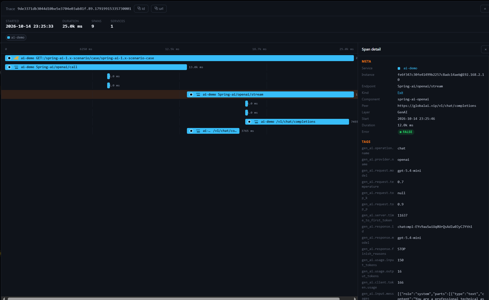

---
title: "How Good Are LLM Answers? Bringing Model Quality into SkyWalking Observability"
author: "peachisai"
date: 2026-09-25
description: "Learn how SkyWalking 10.5.0 uses LLM-as-Judge to evaluate GenAI span input and output messages asynchronously and connect the results to evaluation records, metrics, and traces."
tags:
  - LLM as judge
  - AI evaluation
  - observability
---

## Introduction

Traditional observability focuses on service error rates and latency. These signals do not tell us whether an LLM response is grounded in its context, relevant to the question, or complete. A knowledge-base assistant may return a well-formatted and confident answer without evidence. The trace can still be successful while users consider the answer unreliable. In an AI gateway or agent, model versions, provider health, and routing policies can also change and affect response quality.

SkyWalking already provides OpenTelemetry-based GenAI observability for request volume, success rate, latency, tokens, and estimated cost. SkyWalking 10.5.0 adds LLM-as-Judge on top of this foundation. For sampled GenAI spans, it sends the input and output messages to an OpenAI-compatible judge model, produces configurable evaluation results, and associates them with an evaluation record and the source trace. SCORE tasks also produce a metric for the Virtual GenAI Dashboard and alarms.

## Why use LLM-as-Judge with SkyWalking?

- Datasets and benchmarks are useful for model selection, prompt comparison, and regression testing before a release. They usually use fixed questions and contexts, however, and cannot continuously represent production response quality.
- Production requests keep changing. User questions and contexts differ, model versions are updated, and provider status and traffic patterns fluctuate. Production systems therefore need continuous evaluation of real requests in addition to offline tests.
- LLM-as-Judge generates quality results for real requests, while SkyWalking places those results in the existing observability path. A trace shows the LLM interactions and external calls involved in a request, helping engineers determine whether a quality regression relates to an earlier LLM output, an MCP call, or another external response.
- The Virtual GenAI Dashboard and alarm capabilities show quality trends over time and can alert on abnormal values. This connects quality evaluation, trend monitoring, alerting, and trace investigation into a production observability loop.

## Data flow


```text
GenAI span (with non-empty input/output messages)
    → sample by trace ID
    → asynchronous OAP queue
    → build evaluation tasks and prompt
    → OpenAI-compatible judge
    → parse structured result
    → evaluation record + SCORE metric
    → Virtual GenAI Dashboard / evaluation page / source trace
```

Evaluation runs asynchronously after trace processing and does not synchronously block trace ingestion. The module only processes GenAI spans that contain both non-empty `gen_ai.input.messages` and `gen_ai.output.messages`; spans missing either attribute are skipped.

## Usage

### 1. Enable the module

Configure `application.yml` in SkyWalking:

```yaml
ai-evaluation:
  selector: ${SW_AI_EVALUATION:default}
  default:
    sampleRate: ${SW_AI_EVALUATION_SAMPLE_RATE:1000000}
    bufferSize: ${SW_AI_EVALUATION_BUFFER_SIZE:100}
    consumerThreads: ${SW_AI_EVALUATION_CONSUMER_THREADS:8}
    # Maximum escaped characters included from each input/output message field.
    maxContentLength: ${SW_AI_EVALUATION_MAX_CONTENT_LENGTH:16384}
```

`sampleRate` is expressed in parts per million (PPM): `1000000` evaluates every eligible trace and `10000` evaluates approximately 1%. Sampling uses the trace ID, so spans from the same trace are selected consistently. When the queue is full, new evaluation tasks are dropped instead of blocking trace ingestion. Tune `bufferSize` and `consumerThreads` only after checking judge capacity and OAP resource usage.

Setting the selector alone is not sufficient. OAP also needs a valid endpoint, model, API key, and system prompt in `ai-evaluation.yml`. The evaluator remains inactive when these required settings are missing.

### 2. Configure the judge and tasks

Configure the judge in `ai-evaluation.yml`:

```yaml
judge:
  provider: openai
  endpoint: ${AI_EVALUATION_ENDPOINT:}
  model: ${AI_EVALUATION_MODEL:gpt-5.5}
  api-key: ${AI_EVALUATION_API_KEY:}
  request-timeout-seconds: 30
  max-retries: 2
  temperature: 0.2
  max_tokens: 100000
```

The `provider` currently supports only `openai`, but the endpoint may be any service that accepts the OpenAI Chat Completions request format. Judge requests contain the input and output messages from the span. Before enabling this in production, review data redaction, privacy requirements, the provider's data handling policy, and model usage cost.

The system prompt must require a JSON response. The default prompt is:

```yaml
system-prompt: |
  You are an AI observability evaluator.

  Your task is to evaluate GenAI spans according to the evaluation tasks provided by the user.

  General Rules:
  1. Return ONLY valid JSON.
  2. Do NOT return markdown or code fences.
  3. Do NOT add fields that are not requested or omit an evaluation task.
  4. Each task must contain value and reason.
  5. If the context is insufficient, provide the best evaluation possible and explain the limitation in reason.

  Value Type Rules:
  SCORE: value must be a number between 0.0 and 1.0.
  BOOLEAN: value must be true or false.
  STRING: value must be a string.
  JSON: value must be a valid JSON object.

  Evaluate only the information in the span context. Do not invent missing information.
  Return ONLY the JSON object.
```

Use `level` to define levels for SCORE and BOOLEAN results. SCORE ranges are left-closed and right-open, except that `1.0` belongs to the final range:

```yaml
level:
  undefined: undefined
  score:
    - min: 0.0
      max: 0.3
      level: fail
    - min: 0.3
      max: 0.6
      level: warning
    - min: 0.6
      max: 0.85
      level: good
    - min: 0.85
      max: 1.0
      level: excellent
  boolean:
    "true": excellent
    "false": fail
```

Each task requires `name`, `valueType`, and `instruction`. Supported value types are `SCORE`, `BOOLEAN`, `STRING`, and `JSON`. Evaluation records store every task result: SCORE stores a value from 0.0 to 1.0, BOOLEAN is stored as numeric 0 or 1, and STRING and JSON are stored as string values. Only SCORE tasks additionally report the `gen_ai_model_evaluation_score_ppm` metric; BOOLEAN, STRING, and JSON tasks are not included in this metric.

```yaml
tasks:
  - name: Faithfulness
    valueType: SCORE
    instruction: Evaluate factual grounding. Higher is better.

  - name: Relevance
    valueType: SCORE
    instruction: Evaluate response relevance. Higher is better.

  - name: TaskCompletion
    valueType: BOOLEAN
    instruction: Evaluate task completion.

  - name: Hallucination
    valueType: SCORE
    instruction: Evaluate factuality and absence of hallucinations. Higher is better.
```

Every task result contains `value` and `reason`. SCORE metrics are stored in PPM: for example, `0.8` is stored as `800000`, so divide by `1000000` when displaying the original score. You can define custom evaluation dimensions and use `allowedValues` for STRING tasks.

### 3. Receive GenAI traces

Start OAP and send GenAI traces to SkyWalking. See the [GenAI observability guide](../2026-04-05-virtual-genai-monitoring/index.md) for instrumentation details. Make sure the ingestion path exports `gen_ai.input.messages` and `gen_ai.output.messages`; otherwise the span will not enter the evaluation queue.

### 4. View evaluation records


In the SkyWalking UI evaluation page, filter records by task, value type, trace ID, and other fields. Records also retain the service, provider, model, operation, task, value, level, reason, judge model, and evaluation time.

### 5. Follow an evaluation to its trace


Click a task to view its result details:



Click the Trace link in the upper-right corner to open the source trace and inspect the complete agent interaction, LLM calls, and external tool calls.

### 6. View quality metrics in the Dashboard


The Virtual GenAI Dashboard provides the `gen_ai_model_evaluation_score_ppm` metric. View SCORE trends by service instance, model, and task, and create alarms from the metric. Also monitor `ai_evaluation_dropped_count` and `ai_evaluation_error_count` so evaluation throughput problems are not mistaken for model quality regressions.

