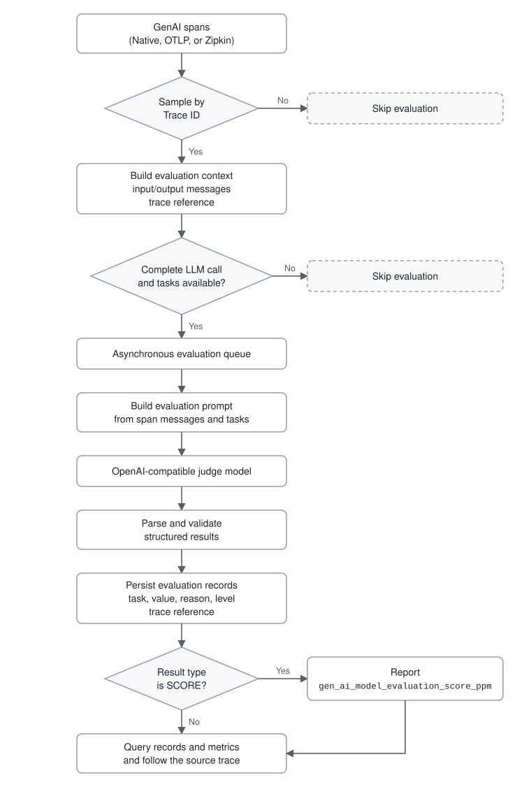
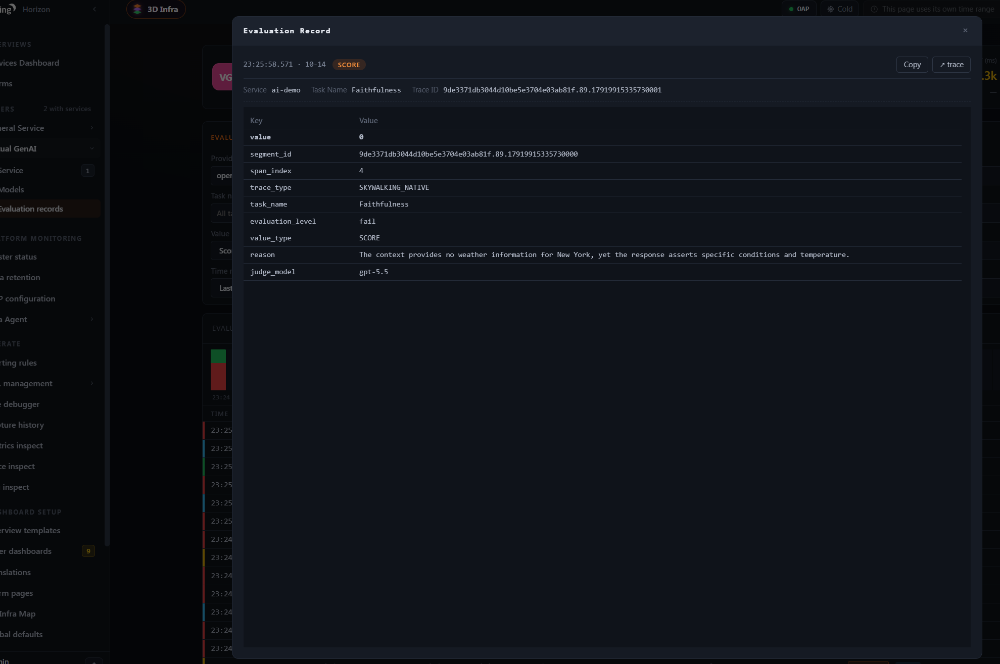

## Introduction

Traditional observability focuses on service error rates and latency. These signals do not tell us whether an LLM response is grounded in its context, relevant to the question, or complete. A knowledge-base assistant may return a well-formatted and confident answer without evidence. The trace can still be successful while users consider the answer unreliable. In an AI gateway or agent, model versions, provider health, and routing policies can also change and affect response quality.

SkyWalking already provides OpenTelemetry-based GenAI observability for request volume, success rate, latency, tokens, and estimated cost. The upcoming SkyWalking 11.1.0 release adds LLM-as-Judge on top of this foundation. For sampled GenAI spans, it sends the input and output messages to an OpenAI-compatible judge model, produces configurable evaluation results, and associates them with an evaluation record and the source trace. SCORE tasks also produce a metric for the Virtual GenAI Dashboard and alarms.

## Why use LLM-as-Judge with SkyWalking?

- Datasets and benchmarks are useful for model selection, prompt comparison, and regression testing before a release. They usually use fixed questions and contexts, however, and cannot continuously represent production response quality.
- Production requests keep changing. User questions and contexts differ, model versions are updated, and provider status and traffic patterns fluctuate. Production systems therefore need continuous evaluation of real requests in addition to offline tests.
- LLM-as-Judge generates quality results for real requests, while SkyWalking places those results in the existing observability path. A trace shows the LLM interactions and external calls involved in a request, helping engineers determine whether a quality regression relates to an earlier LLM output, an MCP call, or another external response.
- The Virtual GenAI Dashboard and alarm capabilities show quality trends over time and can alert on abnormal values. This connects quality evaluation, trend monitoring, alerting, and trace investigation into a production observability loop.

## Data flow



Evaluation is asynchronous: eligible GenAI spans are queued, and trace ingestion never waits for the judge. The module only processes GenAI spans that contain both non-empty `gen_ai.input.messages` and `gen_ai.output.messages`; spans missing either attribute are skipped.

## Usage

This guide targets SkyWalking 11.1.0. Until that version is released, use an `11.1.0-SNAPSHOT` development build of OAP. The evaluation pages shown below are in the `main` branch of Horizon UI and not in Horizon UI 1.0.1, so use the `ghcr.io/apache/skywalking-horizon-ui:main` image until Horizon UI 1.1.0 is released.

### 1. Enable the module

The module is disabled by default. Set `SW_AI_EVALUATION=default` when starting OAP to enable it. The module settings in `application.yml` are:

```yaml
ai-evaluation:
  selector: ${SW_AI_EVALUATION:-}
  default:
    sampleRate: ${SW_AI_EVALUATION_SAMPLE_RATE:1000000}
    bufferSize: ${SW_AI_EVALUATION_BUFFER_SIZE:100}
    consumerThreads: ${SW_AI_EVALUATION_CONSUMER_THREADS:8}
    # Maximum escaped characters included from each input/output message field.
    maxContentLength: ${SW_AI_EVALUATION_MAX_CONTENT_LENGTH:16384}
```

`sampleRate` is expressed in parts per million (PPM): `1000000` evaluates every eligible trace and `10000` evaluates approximately 1%. Sampling uses the trace ID, so spans from the same trace are selected consistently. When the queue is full, new evaluation tasks are dropped instead of blocking trace ingestion. Tune `bufferSize` and `consumerThreads` only after checking judge capacity and OAP resource usage.

Setting the selector alone is not sufficient. OAP also needs a valid endpoint, model, API key, and system prompt in `ai-evaluation.yml`. The evaluator remains inactive when these required settings are missing.

### 2. Configure the judge and tasks

Configure the judge in `ai-evaluation.yml`:

```yaml
judge:
  provider: openai
  endpoint: ${AI_EVALUATION_ENDPOINT:}
  model: ${AI_EVALUATION_MODEL:gpt-5.5}
  api-key: ${AI_EVALUATION_API_KEY:}
  request-timeout-seconds: 30
  max-retries: 2
  temperature: 0.2
  max_tokens: 100000
```

The `provider` currently supports only `openai`. The endpoint may be any service that accepts OpenAI Chat Completions requests and returns the judge's JSON result in `choices[0].message.content`. Judge requests contain the input and output messages from the span. Before enabling this in production, review data redaction, privacy requirements, the provider's data handling policy, and model usage cost.

The system prompt must require a JSON response. The default prompt is:

```yaml
system-prompt: |
  You are an AI observability evaluator.

  Your task is to evaluate GenAI spans according to the evaluation tasks provided by the user.

  General Rules:

  1. Return ONLY valid JSON.
  2. Do NOT return markdown.
  3. Do NOT return code fences.
  4. Do NOT return explanations outside the JSON result.
  5. Do NOT add any fields that are not requested.
  6. Do NOT omit any evaluation task.
  7. The JSON keys MUST appear in exactly the same order as the evaluation tasks provided by the user.
  8. Each evaluation task MUST contain:
     - value
     - reason
  9. The reason field should be concise and explain the evaluation result in one or two sentences.
  10. If the available context is insufficient, provide the best evaluation possible and explain the limitation in the reason field.

  Value Type Rules:

  SCORE
  - value must be a number between 0.0 and 1.0.
  - 1.0 represents the best possible evaluation result.
  - 0.0 represents the worst possible evaluation result.

  BOOLEAN
  - value must be either true or false.

  STRING
  - value must be a string.

  JSON
  - value must be a valid JSON object.

  Evaluation Principles:

  - Evaluate only using the information provided in the span context.
  - Do not assume facts that are not present in the input.
  - Do not invent missing information.
  - Be objective and consistent.
  - Use the task instruction as the primary evaluation criterion.

  Return ONLY the JSON object.
```

Use `level` to define levels for SCORE and BOOLEAN results. A SCORE range includes `min` and excludes `max`, except that a range with `max: 1.0` also includes `1.0`:

```yaml
level:
  undefined: undefined
  score:
    - min: 0.0
      max: 0.3
      level: fail
    - min: 0.3
      max: 0.6
      level: warning
    - min: 0.6
      max: 0.85
      level: good
    - min: 0.85
      max: 1.0
      level: excellent
  boolean:
    "true": excellent
    "false": fail
```

Each task requires `name`, `valueType`, and `instruction`. Supported value types are `SCORE`, `BOOLEAN`, `STRING`, and `JSON`. Evaluation records keep every valid task result, and invalid results are skipped. SCORE and BOOLEAN values are stored as numbers in PPM (a score of `0.8` becomes `800000`, `true` becomes `1000000`, and `false` becomes `0`), and STRING and JSON values are stored as strings. Only SCORE tasks additionally report the `gen_ai_model_evaluation_score_ppm` metric; BOOLEAN, STRING, and JSON tasks are not included in this metric.

```yaml
tasks:
  - name: Faithfulness
    valueType: SCORE
    instruction: Evaluate factual grounding. Higher is better.

  - name: Relevance
    valueType: SCORE
    instruction: Evaluate response relevance. Higher is better.

  - name: TaskCompletion
    valueType: BOOLEAN
    instruction: Evaluate task completion.

  - name: Hallucination
    valueType: SCORE
    instruction: Evaluate factuality and absence of hallucinations. Higher is better.
```

The system prompt treats `1.0` as the best result, and the levels above map higher scores to better levels, so write every SCORE instruction so that a higher score means a better answer. That is why the Hallucination task above scores the absence of hallucinations rather than their severity.

Every task result contains `value` and `reason`. SCORE values in both the records and the metric are in PPM, so divide by `1000000` when displaying the original score. You can define custom evaluation dimensions and use `allowedValues` for STRING tasks.

### 3. Receive GenAI traces

Start OAP and send GenAI traces to SkyWalking. See the [GenAI observability guide](../2026-04-05-virtual-genai-monitoring/) for instrumentation details. Evaluation needs the message content, and the SkyWalking Java agent does not collect it by default. For Spring AI instrumented by the Java agent, enable it explicitly in the environment of the application:

```shell
export SW_PLUGIN_SPRINGAI_COLLECT_INPUT_MESSAGES=true
export SW_PLUGIN_SPRINGAI_COLLECT_OUTPUT_MESSAGES=true
```

For OTLP and Zipkin ingestion, make sure the instrumentation exports `gen_ai.input.messages` and `gen_ai.output.messages`. A span missing either attribute does not enter the evaluation queue.

For OTLP ingestion, OAP 11.1.0 stores spans natively by default (`otlpTraceStorage: otlp`) and evaluates those spans directly, without converting them into Zipkin form.

### 4. View evaluation records


In Horizon UI, open **Virtual GenAI > Evaluation records** and filter records by task, value type, trace ID, and other fields. Records also retain the service, provider, model, operation, task, value, level, reason, judge model, and evaluation time.

### 5. Follow an evaluation to its trace

Click a record to view its details:



For a record from a SkyWalking native trace, like the one below, users with the `traces:read` permission can click the **trace** link in the upper-right corner to open the source trace and inspect the recorded agent interactions, LLM calls, and external tool calls.

Horizon UI `main` does not yet support following an OTLP evaluation record to its natively stored source trace. This UI limitation does not prevent evaluation records from being generated or queried.


### 6. View quality metrics in the Dashboard


The Models dashboard of Virtual GenAI shows the `gen_ai_model_evaluation_score_ppm` metric. In Virtual GenAI, the provider is the service and the model is its instance, so the chart shows SCORE trends per model and task. You can also create alarms from the metric.

Also monitor the OAP self-observability metrics `ai_evaluation_dropped_count` and `ai_evaluation_error_count`, stored as `meter_oap_instance_ai_evaluation_dropped_count` and `meter_oap_instance_ai_evaluation_error_count`, so evaluation problems are not mistaken for model quality regressions. Their `reason` label tells the causes apart: for dropped evaluations, `pipeline_capacity` means the queue was full and `incomplete_span` means the evaluation context or its trace ID was missing, or a span lacked the required messages or its service, provider, model, or trace reference information; errors are split into `rejected`, `timeout`, and `invalid_response`.
