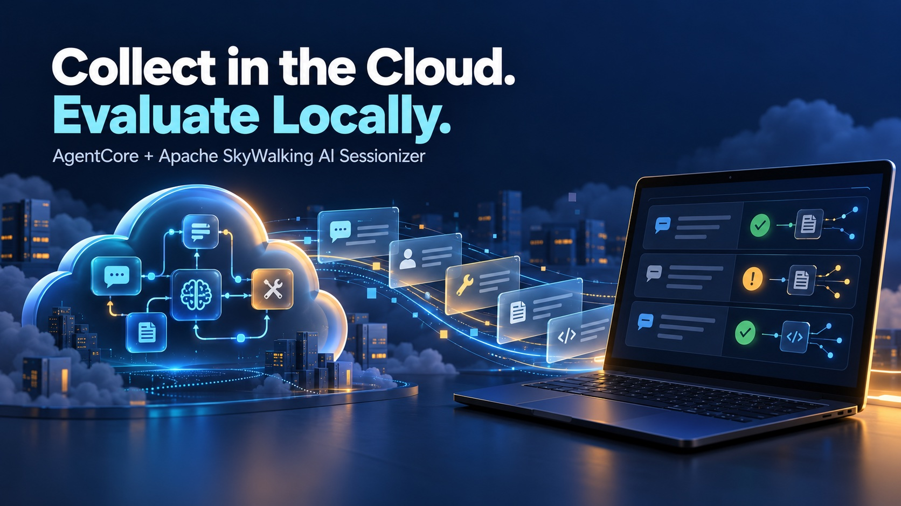
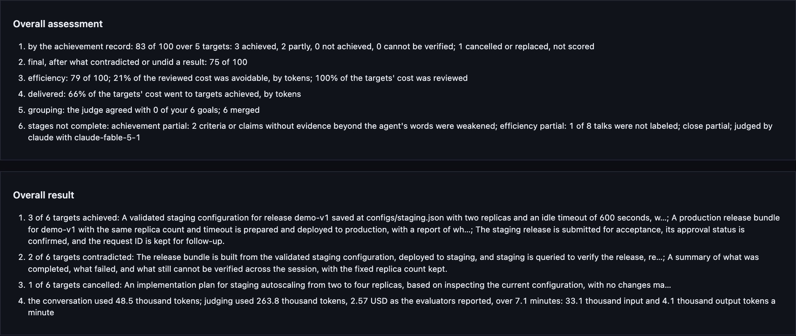

*This post is also published on [AWS Builder Center](https://builder.aws.com/content/3LLbWtrJFcTtJtPtAB7JgxqR8SD/collect-cloud-sessions-evaluate-locally-analyzing-ai-agents-on-amazon-bedrock-agent-core-with-apache-sky-walking-ai-sessionizer). [中文版 / Chinese version](/zh/2026-10-29-ai-sessionizer-agentcore-pull-judge/)*

This walkthrough uses a release assistant to demonstrate the full workflow: ask an agent to change configuration, deploy an application, and query the result, then check whether the work met the requirements. The agent runs on Amazon Bedrock AgentCore. Apache SkyWalking AI Sessionizer (`asz`) records its execution in the cloud. We pull those records onto a development machine, inspect them, and run a judge through a local CLI to check whether the agent met the requirements.

We will follow one example through five steps: **design the agent → deploy and collect → pull and inspect → run the judge → read results against the goals.**

## 1. What the agent should do

The agent's job is to release `demo-v1`. We give it tools for file access, configuration validation, building, deployment, and status queries. The model decides how to use them.

The agent uses LangGraph, runs in AgentCore Runtime, and makes real calls to the Nova Pro model on Amazon Bedrock. The business system is simulated: configuration, bundles, deployment state, and acceptance requests are stored as files. It does not operate a real production application.

We designed seven conversation turns covering normal work, revised requirements, denied permissions, and cancellation:

| Turn | What we ask the agent                                                                                   | What we will check                                                                                    |
| ---- | ------------------------------------------------------------------------------------------------------- | ----------------------------------------------------------------------------------------------------- |
| 1    | Create staging configuration with two replicas and a 300-second timeout; validate it, but do not deploy | The file exists, validation passes, and no deployment occurs                                          |
| 2    | Change the timeout to 600 seconds, keep two replicas, and validate again                                | Both the file and validation result show 600; a reply saying “changed” is not enough                  |
| 3    | Build, deploy to staging, then query and verify configuration                                           | A query after deployment confirms the release, replica count, and timeout                             |
| 4    | Build and deploy production with the same parameters; explain successes and failures                    | Build and deployment are distinguished, and a permission denial is reported accurately                |
| 5    | Submit acceptance, confirm approval status, and retain the request ID                                   | Submission is distinguished from approval; an unconfirmed result remains unknown                      |
| 6    | Inspect configuration, propose scaling from two to four replicas, and wait for confirmation             | Inspection precedes planning, and nothing changes without confirmation                                |
| 7    | Cancel autoscaling, keep two replicas, and summarize results                                            | Autoscaling was not implemented; the summary accurately lists completed, failed, and unconfirmed work |

These requests are stored in [`scenarios/release.json`](https://github.com/wu-sheng/aws-agentcore-asz-demo/blob/main/examples/pull-judge/scenarios/release.json) and sent as real user messages. The right-hand column is our checklist for reading the judge report later.

The simulator deliberately denies production deployment, and acceptance submission returns no approval conclusion. Correct behavior therefore includes **reporting limits accurately when work cannot be completed**. Whether deployment succeeded and whether the agent reported failure honestly are separate questions.

## 2. Deploy and collect

### Deploy the example

Prepare Git, Go 1.27+, uv, OpenSSL, AWS CLI, OpenTofu, and a running Docker engine. Your AWS account needs infrastructure deployment permissions and access to `us.amazon.nova-pro-v1:0` in `us-east-1`.

```sh
git clone --branch main https://github.com/wu-sheng/aws-agentcore-asz-demo.git
cd aws-agentcore-asz-demo/examples/pull-judge
bash scripts/bootstrap.sh
export PATH="$PWD/.work/bin:$PATH"
```

`bootstrap.sh` installs the example dependencies and builds asz. This example has its own directory, preserving the code and deployment process from the [previous article](/blog/2026-10-10-ai-sessionizer-agentcore/).

If you are not signed in to AWS, run `aws login` first. Run the deployment commands below from `examples/pull-judge/`, replacing `YOUR_PUBLIC_IPV4` with your public egress IPv4 address. If you use a proxy, supply its egress address.

```sh
aws sts get-caller-identity
.venv/bin/python scripts/prepare-cloud.py --client-ip YOUR_PUBLIC_IPV4

AGENT_IMAGE=ghcr.io/wu-sheng/aws-agentcore-asz-pull-judge-agent:b3e872bfb9a26fbd8bfac6eab6073d241b79c904 \
  bash scripts/up.sh
```

This uses the image tested in this walkthrough. The script checks model access, copies the image into ECR, and creates the AgentCore Runtime, asz on Fargate, EFS, and networking. Infrastructure and model calls incur AWS charges. The deployment writes its resource manifest to `.work/cloud/resources.txt`.

### Collect execution records and file changes

```text
Agent in AgentCore
  ├─ Conversation, model calls, tool calls ──→ cloud asz
  └─ File changes ──→ shared EFS ──→ cloud asz
                                       │
                                  pull on demand
                                       ↓
                              Local viewing and judging
```

The example configures two collection paths:

* **Execution records:** LangGraph tracing sends user input, model responses, and tool calls to the asz receiver through `LANGSMITH_ENDPOINT`.
* **File changes:** The asz recording component watches `write_file`, `build_release`, `deploy`, and `submit_acceptance`, writing changes to shared EFS for asz to read.

These paths preserve model responses, tool results, and file changes in the same conversation. The agent calls Bedrock using its Runtime IAM role. The cloud runs the agent and asz collection service; Claude Code or Codex runs on your local machine for evaluation.

Now send the seven requests from section 1:

```sh
.venv/bin/python scripts/cloud.py
```

The script invokes the agent turn by turn in one AgentCore session, waits for collection, and automatically pulls snapshots A, B, and C after turns 1, 5, and 7. It prints a `.work/cloud-TIMESTAMP` directory containing:

* `turn-*.json`: Each request and response.
* `checkpoints.json`: Conversation IDs and tags for the three snapshots.
* `client/asz.yaml`: The local configuration for the next step.

## 3. Pull the records and inspect them locally

Remote pull copies a cloud conversation into a local snapshot. Cloud collection continues, while local viewing and evaluation use the fixed version you pulled.

### Connect to cloud asz

Enter the printed run directory, substituting your actual timestamp:

```sh
cd .work/cloud-TIMESTAMP/client
```

The script has already generated `asz.yaml`. Its remote connection section looks like this; the actual file has the address and paths filled in, so you do not need to copy this snippet:

```yaml
remotes:
  - name: demo
    url: https://YOUR_NLB_HOST:8788
    token_file: /path/to/demo.token
    ca_file: /path/to/demo-ca.pem
    server_name: asz-pull-judge.internal
```

`demo` names the remote service, and `token_file` supplies authentication. The last two settings verify the example's self-signed certificate. The deployment script also configures HTTPS and restricts the endpoint to your client IP. See the [remote pull configuration guide](https://skywalking.apache.org/docs/skywalking-ai-sessionizer/next/en/setup/remote-pull/).

List cloud conversations, then pull one:

```sh
asz pull -list -remote demo
asz pull demo/CONVERSATION_ID
```

Replace `CONVERSATION_ID` with an ID from the list. The pull output provides `SNAPSHOT_TAG`; `checkpoints.json` in the parent directory contains the A, B, and C tags already pulled by the script. Later, use `demo/CONVERSATION_ID:SNAPSHOT_TAG` to select that exact data. Pulling again with no new records returns `unchanged`.

### See what the agent actually did

```sh
asz view
```

Open the local address printed by the command and select the pulled conversation. Start with turn 2, where the user asked to change the timeout from 300 to 600. Find three things:

1. The user's change request.
2. The `write_file` change to `configs/staging.json`.
3. The configuration value returned by `validate_config`.

This is the file change pulled from our cloud run:


The final validation read 600, confirming the update. However, the record also shows an earlier validation running alongside the write, reading the old value, and requiring a retry. **The final result can be correct while the execution still contains avoidable rework.** The judge helps organize these findings.

Viewing an existing snapshot does not require cloud asz to be online. Pull again when you need newer data. When finished viewing, press Ctrl+C to stop `asz view` and continue with the evaluation commands in the same directory.

## 4. Evaluate the agent against its goals and generate an HTML report

The judge identifies tasks from the user's requests, then checks whether tool results, file changes, and replies support completion. We can also provide the design goals from section 1, so the report follows our own checklist.

### Prepare the local CLI and goal list

Install and sign in to Claude Code, and make sure your terminal can run `claude`. asz starts it for evaluation; conversation content it reads goes to its model service. For Codex, replace `-evaluator claude` with `-evaluator codex` in the commands below.

The `bootstrap.sh` command in section 2 installs an asz CLI with HTML reporting support (commit `07a2d95`); no additional build is needed. The cloud experiment and recording components used `341f8c0`; existing snapshots do not need to be collected again.

Continue in `.work/cloud-TIMESTAMP/client/`. The example's `scenarios/judge-goals.yaml` organizes the seven requests into six goals: configuration, staging deployment and verification, production deployment, acceptance, autoscaling and cancellation, and the final summary. Copy it into the current directory:

```sh
cp ../../../scenarios/judge-goals.yaml goals.yaml
```

The file is a simple list. For example, one entry reads:

```yaml
goals:
  - Build and deploy staging, then query it to verify the release, replica count and timeout.
```

Use the complete file copied above, which contains six goals. For your own scenario, specify the expected result, such as querying after deployment to confirm the release, replica count, and timeout. This list organizes report tasks for comparison with the design in section 1.

### Run the evaluation

After all requests in section 1 have finished, including the final request to cancel scaling and summarize the results, evaluate the conversation snapshot pulled in section 3. This gives the judge the full history of requirement changes and cancellation. From `client/`, run:

```sh
asz judge -evaluator claude -goals goals.yaml \
  -remote-conversation demo/CONVERSATION_ID:SNAPSHOT_TAG
```

Replace `CONVERSATION_ID` and `SNAPSHOT_TAG` with the conversation ID and snapshot tag from the pull output in section 3. If you use the snapshots pulled automatically by the script, choose entry C in `checkpoints.json`; it contains the conversation after all requests have finished. The command evaluates the local records and groups the identified tasks under our goals. Each evaluation is saved as a numbered record called a run. It does not execute the agent's release tools again or require cloud asz to be online.

If a judge run already exists and you only want to organize it by this goal list, use that saved run:

```sh
asz judge -regroup 1 -goals goals.yaml -evaluator claude \
  -remote-conversation demo/CONVERSATION_ID:SNAPSHOT_TAG
```

`-regroup` calls the evaluator to regroup existing tasks while preserving their criteria, evidence, and scores. **`-goals` provides a goal list, not scoring rules.** When reading the report, check whether the completion criteria identified by the judge match the original requests. The report shown here uses existing run 1 from the complete conversation snapshot, regrouped under six goals and exported.

### Export the HTML report and open it in a browser

List the saved evaluations, then export the run you want to inspect. This example selects run 1; replace the number in `-run 1` to select another record:

```sh
asz judge -list \
  -remote-conversation demo/CONVERSATION_ID:SNAPSHOT_TAG

asz judge -show -run 1 -format html \
  -remote-conversation demo/CONVERSATION_ID:SNAPSHOT_TAG > judge-report.html
```

Open `judge-report.html` in your browser. It needs no web server and includes its own styles, making it convenient to retain or share the detailed report. Export reads saved results without calling the model again.

`-show` defaults to the latest closed run; `-run 1` selects run 1 explicitly. Use `-format markdown` instead of HTML for a concise summary, or `-show -run 1 -json` for the raw stage data. See the [judge command documentation](https://skywalking.apache.org/docs/skywalking-ai-sessionizer/next/en/setup/judge/).

## 5. Review evaluation results in the browser

Start by selecting a task in the Goals table, expand its completion criteria and evidence, then read the overall scores and summary. We will use this order to check the six goals from section 1.

The report below evaluates all requests in this AgentCore conversation and organizes the results under the six goals from section 1. The [HTML report](https://github.com/wu-sheng/aws-agentcore-asz-demo/blob/main/docs/blog/pull-judge/assets/judge-C.html) is included in the repository and can be saved and opened locally.

### First: Find the work in the Goals table

The table has **Goal, Target, Status, and Score** columns. A Goal is the result we wanted. A Target is a specific task identified by the evaluator. Status describes its outcome, and Score gives its score. Select **Check details** to inspect the task.


Staging configuration is marked `achieved` with 100; staging deployment and verification is marked `contradicted` with zero. The first means the judge found the task completed. The second means the agent’s completion claim conflicts with the recorded evidence. Expand both tasks to see why.

### Second: Expand Criteria, Done, and Missing

| Page section | Question to answer                                                                |
| ------------ | --------------------------------------------------------------------------------- |
| **Criteria** | What counts as completion? Was each condition met, and what evidence supports it? |
| **Done**     | What work did the agent actually complete?                                        |
| **Missing**  | Which requirements are unmet, lack evidence, or involved problems along the way?  |

This is the expanded staging deployment task. Criteria, completed work, and missing work appear side by side for direct comparison.


**Configuration: completed, with rework.** Check the criteria for two replicas, 600 seconds, and validation after the update. File changes and the final validation support them. Done describes the configuration work. Missing lists two rounds of rework caused by parallel writes and validation, along with avoidable usage. A score of 100 means the result met the requirements, not that execution was error-free.

**Staging: deployment returned success, but verification was incomplete.** Done shows the built bundle and a successful deployment tool result with saved simulated state. Missing shows that the query ran alongside deployment, returned `not_deployed`, and was never repeated. Compare that with section 1's requirement to verify after deployment: the gap is clear.

The task shows two scores: 40 by the achievement record, and a final score of zero after accounting for the conflicting completion claim. Read both the build work in Done and the missing post-deployment verification in Missing.

This is a remote pull snapshot. The HTML includes saved criteria and evidence excerpts but does not embed the original conversation steps. Use `asz view` from section 3 to inspect full tool requests, responses, and file changes.

### Third: Compare criteria and evidence with the original requirements

The production task illustrates a different issue: the judge’s completion criteria are weaker than the user’s request. Section 1 asks for deployment to production, but the evaluation defined one condition as attempting deployment. The tool returned `denied` and `deployed: false`, yet the report marked the task `achieved` because an attempt satisfied that condition.

Against the original request, the conclusions are: **production deployment was not completed; the agent correctly reported the denial.** Grouping the task under the production goal does not correct that loose criterion. Read the evaluation alongside the original request, Criteria, and tool evidence.

Use the same approach for the remaining goals:

| Original requirement                                   | Assessment of this run                                                                                                                   |
| ------------------------------------------------------ | ---------------------------------------------------------------------------------------------------------------------------------------- |
| Submit acceptance and confirm approval                 | Request ID retained, but `approved: null`. Submission completed; approval remains unknown. An achieved label does not establish approval |
| Inspect before planning autoscaling, wait, then cancel | No autoscaling implementation, and the cancelled target is unscored. Fresh inspection before proposing the plan was still missing        |
| Summarize completed, failed, and unconfirmed work      | The summary should include the unresolved staging verification                                                                           |

### Fourth: Review overall scores, evaluation completeness, and the summary

Scroll to the bottom of the report for **Overall assessment** and **Overall result**. These sections summarize the whole conversation; the Goals table above shows individual task results.



Read the four values in Overall assessment above as follows:

| Metric                              | Value  | Meaning                                                                                                             |
| ----------------------------------- | ------ | ------------------------------------------------------------------------------------------------------------------- |
| Achievement record score            | 83/100 | Score based on the record of completed and incomplete work                                                          |
| Final score                         | 75/100 | Score after accounting for completion claims that conflict with the evidence                                        |
| Efficiency score                    | 79/100 | With tokens as the unit, about 21% of reviewed usage was classified as avoidable work                               |
| Usage allocated to achieved targets | 66%    | Share of target-attributed usage allocated to targets judged achieved; it does not mean 66% of tasks were completed |

These numbers describe completion and execution efficiency in this run, not model accuracy on other tasks.

This run also reports `grouping: the judge agreed with 0 of your 6 goals; 6 merged`. The original evaluation grouped all six tasks under one release goal, while our checklist separates them. This is a grouping difference, not six failed goals.

Also check whether the evaluation itself is complete. Two completion judgments relied only on the agent’s own statements, so the report reduced the credit given to them. Efficiency analysis also left work unclassified, and the report is `partial`. This describes an incomplete evaluation; keep these limits in mind when reading the scores. See the [scoring and evidence rules](https://skywalking.apache.org/docs/skywalking-ai-sessionizer/next/en/concepts-and-designs/conversation-judge/).

**Overall result** summarizes achieved, contradicted, and cancelled tasks in words, and distinguishes agent usage from judging usage. The original conversation used about 48.5 thousand tokens; the original evaluation used about 263.8 thousand. Regrouping is an additional evaluator call, recorded separately from the original run. The evaluation usage above excludes that additional regrouping call.

### Decide what to change

The clearest improvement is to sequence dependent tools: **write configuration → validate → build → deploy → query and confirm**. Also require the final summary to distinguish completed, denied, and still-unconfirmed work.

After making changes, run the same seven requests, pull a new snapshot, and judge again. Keep using the checklist from section 1: was verification completed, did rework decrease, and is the summary accurate?

### Clean up the experiment

When finished, preserve the snapshots and reports you need, then return to `examples/pull-judge/` to clean up:

```sh
bash scripts/down.sh --yes
bash scripts/down.sh check
```

Snapshots have retention limits. Exclude tokens and TLS private keys from archives. If network cleanup is waiting for AgentCore to release interfaces, follow the `check` output. The [example README](https://github.com/wu-sheng/aws-agentcore-asz-demo/tree/main/examples/pull-judge) has detailed cleanup instructions.

Find the code in the [example repository](https://github.com/wu-sheng/aws-agentcore-asz-demo/tree/main/examples/pull-judge) and additional results in the [experiment record](https://github.com/wu-sheng/aws-agentcore-asz-demo/blob/main/docs/blog/pull-judge/CLOUD-RESULTS.md). Full usage instructions are in the [Apache SkyWalking AI Sessionizer documentation](https://skywalking.apache.org/docs/skywalking-ai-sessionizer/next/readme/).
