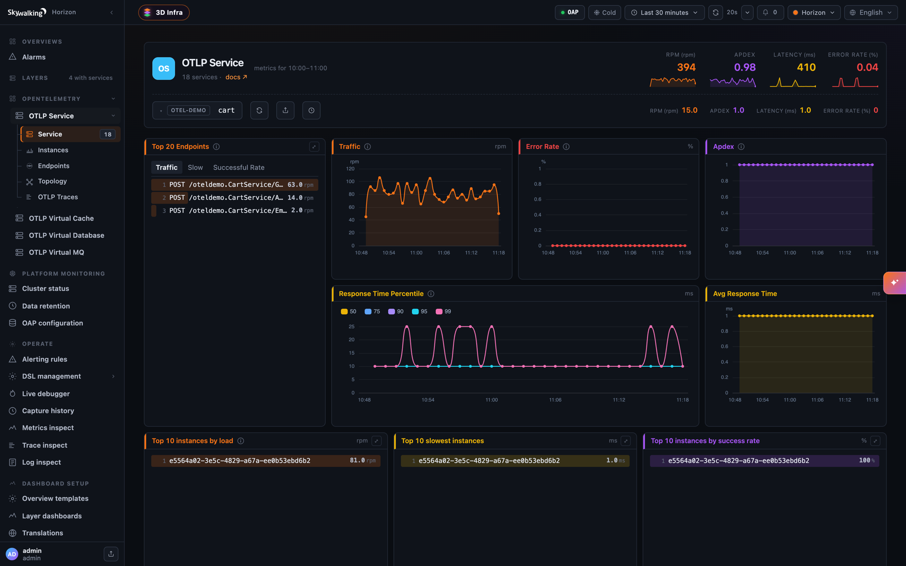
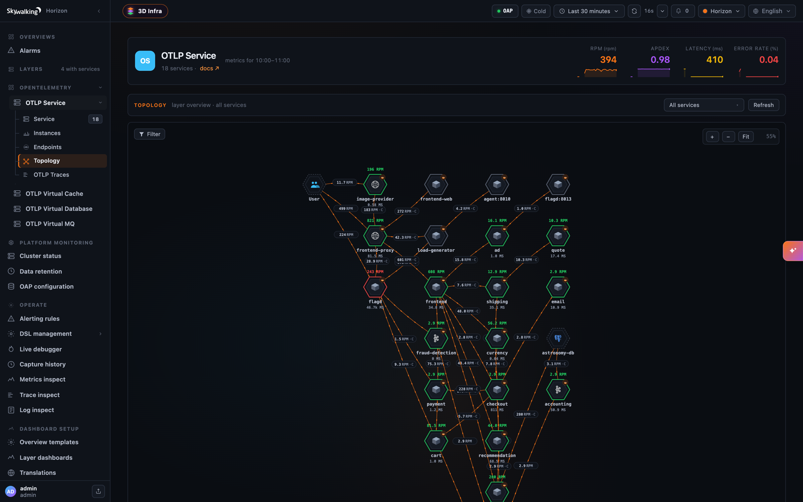
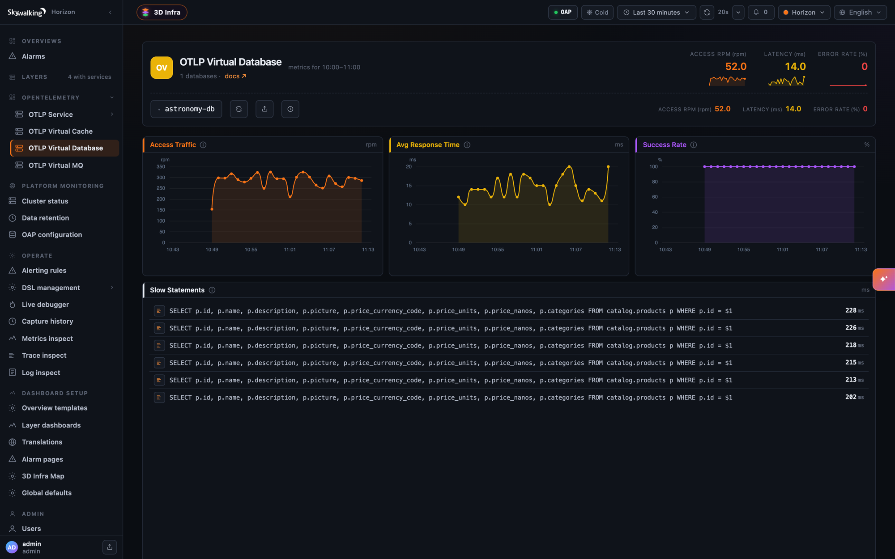
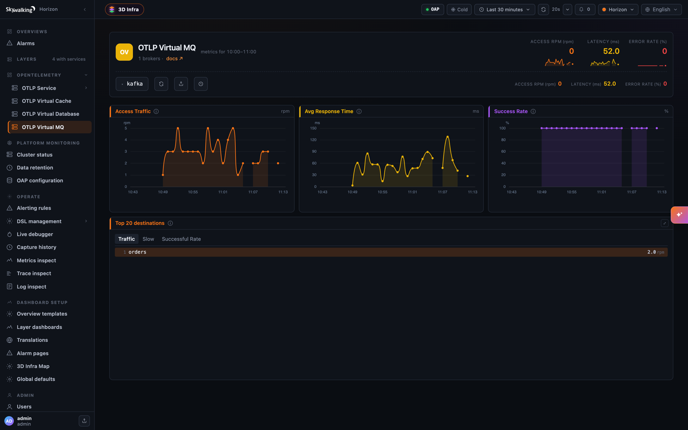
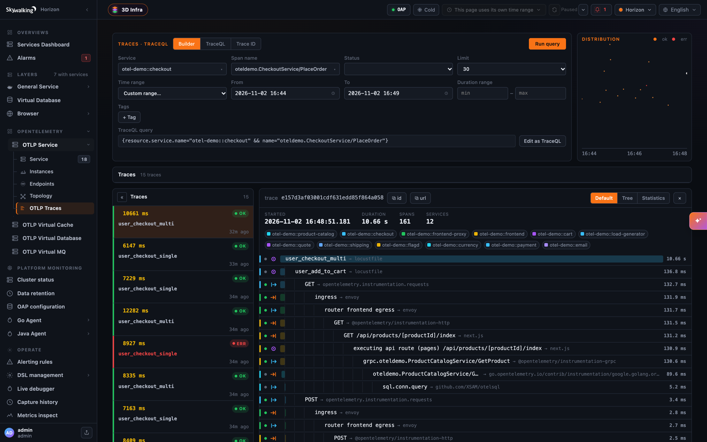
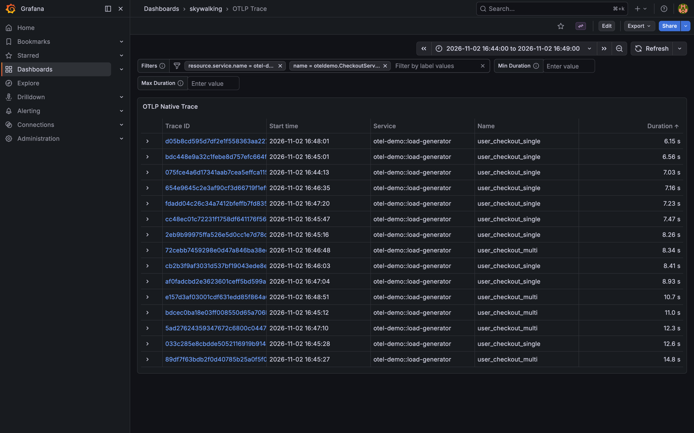
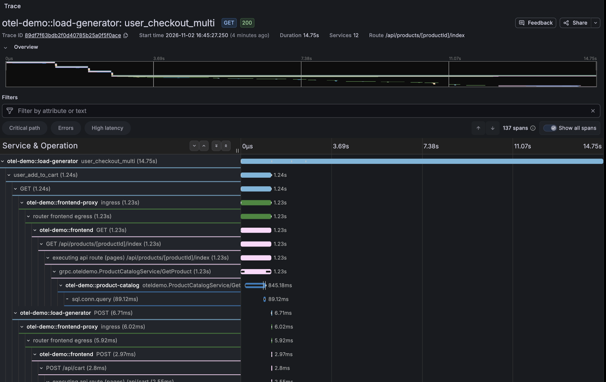

If your services are already instrumented with the OpenTelemetry SDKs, you no longer need a SkyWalking agent to get
SkyWalking's service dashboards, topology and trace search. Point the OTLP exporter at the OAP, add one resource
attribute, and the spans become:

- **stored traces**, kept exactly as the SDK sent them and searchable with TraceQL, in Horizon UI or in Grafana;
- **service, instance and endpoint metrics** — traffic, latency, percentiles, success rate, Apdex — computed from every
  span, named and counted the same way as the agent-based `GENERAL` layer;
- **a topology**, including the databases, caches and message brokers the services call, each with its own dashboard.

This post walks through the whole path on a laptop with the
[OpenTelemetry Astronomy Shop](https://github.com/open-telemetry/opentelemetry-demo), using the
[SkyWalking Showcase](https://github.com/apache/skywalking-showcase), and then shows what to change to do the same
with your own applications.

> The features in this post are available since SkyWalking **11.1.0**.

## What changed

Earlier releases accepted OTLP traces too, but converted every span to the Zipkin v2 model and stored the Zipkin copy.
That conversion is lossy: `INTERNAL` spans lose their kind, every attribute becomes a string, events and links are
flattened into tags, and the resource and instrumentation scope are merged into the span. And the spans were only
stored — no metrics or topology came out of them.

Two things are new:

1. **Native OTLP storage.** `receiver-otel` stores each span as the `ResourceSpans` it arrived in
   (`otlpTraceStorage: otlp`, now the default). A query returns the exact resource, scope, typed attributes, events,
   links and status the SDK sent. The TraceQL module serves these spans at `http://<oap>:3200/otlp`, to Horizon UI
   and to Grafana as a Tempo datasource.
2. **Trace Analysis Language (TAL).** The new `trace-analyzer` module runs rules over every accepted span and turns
   them into metrics, topology and records. The shipped rule file, `tal/otlp-general.yaml`, reads the OpenTelemetry
   semantic conventions and produces four layers:

| Layer                   | Shown in Horizon as     | Holds                                                         |
|-------------------------|-------------------------|---------------------------------------------------------------|
| `OTLP_GENERAL`          | OTLP Service            | your services, their instances and endpoints                  |
| `OTLP_VIRTUAL_DATABASE` | OTLP Virtual Database   | databases the client spans name through `db.system.name`      |
| `OTLP_VIRTUAL_CACHE`    | OTLP Virtual Cache      | Redis, Valkey, Memcached and the other cache systems          |
| `OTLP_VIRTUAL_MQ`       | OTLP Virtual MQ         | brokers the producer and consumer spans name                  |

A fifth layer, `OTLP_MESH`, labels the spans of service mesh sidecars: they are stored and searchable, but no rule
analyzes them, see [Service mesh sidecars](#service-mesh-sidecars).

```
 OTel SDKs ──OTLP──▶ OTel Collector ──OTLP gRPC :11800──▶ OAP receiver-otel
                                                           │
                                   ┌───────────────────────┴───────────────────────┐
                                   ▼                                               ▼
                       trace-analyzer (TAL rules)                           otlp_span
                  metrics · topology · slow statements
                                   │                                               │
                                   ▼                                               ▼
                       Horizon UI layer dashboards              TraceQL /otlp on :3200 (Horizon, Grafana)
```

The collector is optional: SDKs can export straight to the OAP on `11800` (OTLP/gRPC) or `12800` (OTLP/HTTP,
`POST /v1/traces`, protobuf or JSON).

To keep the earlier behavior, set `SW_OTEL_TRACE_STORAGE=zipkin` and enable the Zipkin receiver and query
(`SW_RECEIVER_ZIPKIN=default`, `SW_QUERY_ZIPKIN=default`; the OAP refuses to start without the receiver): the spans
are converted to Zipkin v2 as before and queried through the Zipkin API, the Lens UI or the TraceQL `/zipkin`
datasource, and, unlike earlier releases, the trace analysis now runs on them too.

## Run it in one command

You need `git`, `make` and Docker with about 10 GB of memory available; the containers below use about 8.5 GB once
running.

```shell
git clone https://github.com/apache/skywalking-showcase.git
cd skywalking-showcase
make deploy.docker FEATURE_FLAGS=single-node,otlp-trace,grafana
```

The three feature flags deploy:

- `single-node` — BanyanDB, one OAP and Horizon UI;
- `otlp-trace` — the Astronomy Shop: its microservices, written in many languages and each instrumented with that
  language's OpenTelemetry SDK, their Postgres, Valkey and Kafka, an OpenTelemetry Collector that sends every span to
  the OAP, and a Locust load generator;
- `grafana` — Grafana with an `OTLPTraceQL` Tempo datasource and an `OTLP Trace` dashboard (optional).

The first run pulls the images, which takes a while. When `docker ps` shows the containers healthy:

| What                     | Where                    | Login                 |
|--------------------------|--------------------------|-----------------------|
| Horizon UI               | http://localhost:8081    | `admin` / `admin`     |
| The Astronomy Shop       | http://localhost:8088    | —                     |
| Grafana                  | http://localhost:3000    | `admin` / `admin`     |

The load generator starts on its own, so services appear in Horizon within a couple of minutes.

If the demo runs for a long time on Docker Desktop, checkout traces may show durations of minutes. The spans of the
demo's PHP `quote` service then fall behind the others, because its timestamps drift behind the wall clock while it
runs; restart it with `docker restart docker-otel-demo-quote-1` to bring them back in line.

To remove everything:

```shell
make undeploy.docker FEATURE_FLAGS=single-node,otlp-trace,grafana
```

## What the showcase configures

Three settings carry the whole feature. They are worth knowing because they are exactly what you set for your own
applications.

**1. The OAP stores OTLP traces natively and serves them over TraceQL.** In
`deploy/platform/docker/docker-compose.single-node.yaml`:

```yaml
  oap:
    environment:
      SW_TRACEQL: default
      SW_TRACEQL_ENABLE_DATASOURCE_OTLP: "true"   # the /otlp datasource on port 3200
```

The OTLP receiver is enabled and `otlpTraceStorage` is `otlp` by default, and neither the Zipkin receiver nor the
Zipkin query is needed for it.

**2. The spans opt into the analysis with `service.layer=OTLP_GENERAL`.** The shipped TAL rules analyze only spans
whose resource carries this attribute; any other span is stored and searchable, but produces no metrics. The showcase
sets it once, in the collector (`config/opentelemetry-demo/otel-collector-config.yaml`), rather than in every
service:

```yaml
processors:
  resource/layer:
    attributes:
      - key: service.layer
        value: OTLP_GENERAL
        action: insert
```

**3. The services are grouped by namespace.** The demo's services set `service.namespace=otel-demo`, and the
showcase's `docker-compose.otlp-trace.yaml` tells the OAP to use it as the group:

```yaml
  oap:
    environment:
      SW_OTEL_RECEIVER_OTLP_SERVICE_GROUP: service.namespace
```

So `cart` becomes `otel-demo::cart` — the same `group::name` convention the SkyWalking agents use — in the
metrics, topology, stored spans and logs. This is optional; leave it unset and the service is plain `cart`.

## Service dashboards

Open Horizon UI and choose **OPENTELEMETRY → OTLP Service**. Every service of the demo is there, with the same
kind of widgets as an agent-instrumented service: the top endpoints, traffic, error rate, Apdex, response time
percentiles, and the instances.



Instances come from the resource attribute `service.instance.id`. Not every OpenTelemetry SDK sets it: in the demo,
`cart`, `ad` and `payment` report one, while `frontend`, `checkout` and others do not, so their instance widgets stay
empty. Set it yourself where it is missing, for example to the pod name through `OTEL_RESOURCE_ATTRIBUTES`.

The metrics are computed from every span the OAP receives, **before** the receiver's head sampling
(`otlpTraceSampleRate`) and rate limit (`otlpTraceMaxSpansPerSecond`). Sampling the stored traces down does not make
the metrics undercount.

## Topology

**OTLP Service → Topology** draws the services, the `User` node for requests that enter from outside, and the
databases, caches and brokers they call:



A detail worth knowing about how this works. An OpenTelemetry client span does not name the service it calls, only
the address it dialed — `frontend` calls `cart:7070`, or even a resolved pod IP. The trace analyzer pairs a client
span with the server span that is its child, learns that `otel-demo::frontend` dialing `cart:7070` reached
`otel-demo::cart`, and the topology folds the address onto the service. Pairing runs on a sample of the traces
(`pairingSamplePercent`, 25 by default) and only has to succeed once per caller and address, so on a fresh deploy
you may see a few `ip:port` nodes in the first minutes before they fold away.

An address stays a node of its own when no server span can be paired with it. In the showcase you will see two:

- `agent:8010` — the load generator also calls the demo's AI agent, which the showcase does not deploy, so nothing
  answers.
- `flagd:8013` — some feature-flag clients do not propagate the trace context to `flagd`, so its server span starts a
  trace of its own and cannot be paired with the caller.

Both are faithful to what the spans say. When your own topology shows an address where you expect a service, check
that the callee is instrumented and that the caller propagates the context.

## Databases, caches and message queues

The client spans of the demo's Postgres, Valkey and Kafka calls create services in the three virtual layers, each
with access traffic, latency and success rate. The database dashboard also lists slow statements, the database client
spans above 200 ms, refreshed every 10 minutes by default (`SW_CORE_TOPN_REPORT_PERIOD`):





A database, cache or broker is named by the address the client dialed, and by its `db.system.name` and
`db.namespace`, or `messaging.system`, when the span carries no address. If clients reach one cluster at several
addresses — a Kafka bootstrap list, Redis replicas — list them in `server-clusters.yml` to show them as one service.

## Traces

**OTLP Service → OTLP Traces** searches the stored spans with TraceQL. Use the builder, or type a query:

```
{resource.service.name="otel-demo::checkout" && name="oteldemo.CheckoutService/PlaceOrder"}
{resource.service.layer="OTLP_GENERAL" && span.http.response.status_code=500}
```

Opening a result shows the whole trace. The one below is a checkout from the load generator: 161 spans across 12
services, through the Envoy proxy, the Next.js frontend, the gRPC services and down to the SQL calls.



Because the spans are stored as they arrived, a trace keeps everything the SDK sent. For example, a span of
`otel-demo::checkout`, the Go service that places orders, comes back with:

- its kind, `SPAN_KIND_INTERNAL` included (`prepareOrderItemsAndShippingQuoteFromCart`);
- typed attributes — `server.port` and `demo.cart.items.count` as integers, `demo.shipping.amount` as a double;
- its instrumentation scope, such as `go.opentelemetry.io/contrib/instrumentation/google.golang.org/grpc/otelgrpc`;
- its events, and the full resource: `service.version`, `service.criticality`, `host.name`, `process.*`, `os.*`,
  `telemetry.sdk.*`.

The same data is available to Grafana. The showcase provisions a Tempo datasource named `OTLPTraceQL` at
`http://oap:3200/otlp` and an **OTLP Trace** dashboard. Its **Filters** bar takes any condition from drop-downs: pick
`resource.service.name` first, and `name` then lists that service's span names. Here the checkout service's
`PlaceOrder` spans:



Clicking a trace ID opens the whole trace, here a checkout of 137 spans across 12 services:



To use them in your own Grafana (12 or later), create a Tempo datasource at `http://<oap-host>:3200/otlp`, turn its
**Streaming** option off, and import the dashboards from
[deploy/platform/config/grafana/dashboards](https://github.com/apache/skywalking-showcase/tree/main/deploy/platform/config/grafana/dashboards).

## Service mesh sidecars

Envoy sidecars can report OTLP traces too. On Istio, an OpenTelemetry tracing provider sends each sidecar's spans to
the OAP (or to a collector in front of it), and the proxy's environment labels them with their own layer,
`OTLP_MESH`:

```yaml
meshConfig:
  enableTracing: true
  defaultConfig:
    proxyMetadata:
      OTEL_RESOURCE_ATTRIBUTES: service.layer=OTLP_MESH
  extensionProviders:
    - name: skywalking-mesh-otlp
      opentelemetry:
        service: oap.skywalking.svc.cluster.local
        port: 11800
        resourceDetectors:
          environment: {}
```

The `opentelemetry` key makes it an OTLP provider (gRPC by default); Istio's `skywalking` provider type would send
SkyWalking's native protocol instead. The provider traces nothing until a `Telemetry` resource selects it by its name,
here for the whole mesh:

```yaml
apiVersion: telemetry.istio.io/v1
kind: Telemetry
metadata:
  name: mesh-tracing
  namespace: istio-system
spec:
  tracing:
    - providers:
        - name: skywalking-mesh-otlp
      randomSamplingPercentage: 100
```

The showcase does this on Kubernetes with its `als` feature (`make deploy.kubernetes` with `als` in
`FEATURE_FLAGS`, which needs `istioctl`). It runs the music application in the mesh, sends the sidecars' spans
through the OpenTelemetry Collector, and adds `service.namespace=mesh-svr` to their resource, so the
OAP stores them as `mesh-svr::<service>.<namespace>`, for example `mesh-svr::songs.sample-services`: the same name
the access-log (ALS) analysis gives the service in the `MESH` layer.

The sidecars' spans are stored and searchable, with `{resource.service.layer="OTLP_MESH"}` in TraceQL, but keep the
limits in mind:

- **They are not analyzed.** No shipped TAL rule is declared for `OTLP_MESH`, so the sidecars register no service,
  no metrics and no topology. The mesh's topology and metrics come from the
  [access log analysis](https://skywalking.apache.org/docs/main/next/en/setup/envoy/als_setting/) instead, which is
  what the showcase pairs them with.
- **Trace each hop once.** Don't trace the same calls twice, from an application instrumented with an OpenTelemetry
  SDK (with `service.layer=OTLP_GENERAL`) *and* from the Envoy sidecar next to it. A sidecar's spans repeat the calls
  its application's spans already describe, and they sit between them. A call from `frontend` to `cart` then reads:

  ```
  frontend  CLIENT  (application, OTLP_GENERAL)
    frontend's sidecar  (OTLP_MESH)
      cart's sidecar    (OTLP_MESH)
        cart  SERVER    (application, OTLP_GENERAL)
  ```

  `frontend`'s CLIENT span is no longer the parent of `cart`'s SERVER span, so the analyzer cannot pair the two to
  fold the address `frontend` dialed, `cart:7070`, onto `cart`, and the topology keeps an address-named node.
  Labeling the sidecars `OTLP_MESH` keeps them out of the analysis, but not out of the trace. Trace one of the two:
  the applications, with the sidecars' tracing off and the trace context passed through, or the mesh alone, with the
  applications uninstrumented. The showcase's `als` feature keeps the two apart another way: its services run
  SkyWalking agents, which propagate their own `sw8` header, while the sidecars propagate W3C trace context, so an
  agent's trace and a sidecar's trace never join.

So for a mesh, we recommend: **when you need the mesh's metrics and topology, use the
[Envoy access log service (ALS)](https://skywalking.apache.org/docs/main/next/en/setup/envoy/als_setting/)**, which
analyzes every request the sidecars handle into the `MESH` layer's services, instances, endpoints and topology, and
add the sidecars' OTLP traces next to it when you also want to search and read individual requests. That is the
showcase's `als` setup, and the shared `mesh-svr::` names put a service's ALS dashboards and its sidecar traces under
the same name.

See [Service mesh sidecars](https://skywalking.apache.org/docs/main/next/en/setup/backend/trace-analyzer/#service-mesh-sidecars)
in the trace analysis doc for the details.

## Do it with your own applications

Everything above comes down to a few settings.

**On the OAP** (the defaults already receive OTLP and store it natively; turn on the TraceQL datasource to search the
traces):

```shell
SW_TRACEQL=default
SW_TRACEQL_ENABLE_DATASOURCE_OTLP=true
# optional: group services by a resource attribute, e.g. otel-demo::cart
SW_OTEL_RECEIVER_OTLP_SERVICE_GROUP=service.namespace
```

**On each application** (or once in a collector, as the showcase does):

```shell
OTEL_SERVICE_NAME=cart
OTEL_EXPORTER_OTLP_PROTOCOL=grpc                           # most SDKs default to http/protobuf
OTEL_EXPORTER_OTLP_ENDPOINT=http://<oap-host>:11800        # for http/protobuf, use :12800 instead
OTEL_RESOURCE_ATTRIBUTES=service.layer=OTLP_GENERAL,service.namespace=shop
```

**On Horizon UI**, point it at the OAP's TraceQL API (`HORIZON_OAP_TRACEQL_URL=http://<oap-host>:3200`) next to the
query and admin URLs, so the OTLP Traces tab can reach the `/otlp` datasource.

If a service's traces are searchable but its dashboard stays empty, the spans are missing `service.layer`. The OAP
logs one line per such service:

```
Spans of service '…' carry no service.layer, so they are stored but not analyzed
```

A few knobs you may want later:

| Setting (environment variable)                                      | Default                               | What it does                                                                             |
|---------------------------------------------------------------------|---------------------------------------|------------------------------------------------------------------------------------------|
| `otlpTraceSampleRate` (`SW_OTEL_TRACE_SAMPLE_RATE`)                 | `10000`                               | head sampling of stored traces, in 1/10000; metrics are not affected                     |
| `otlpTraceMaxSpansPerSecond` (`SW_OTEL_TRACE_MAX_SPANS_PER_SECOND`) | `0`                                   | spans per second stored before the rest are dropped; `0` is no limit                     |
| `otlpTraceSearchableTags` (`SW_OTEL_TRACE_SEARCHABLE_TAG_KEYS`)     | HTTP, RPC, DB, MQ and deployment keys | attributes offered by tag autocomplete; every attribute is searchable by equality anyway |
| `dedupWindow` (`SW_TRACE_TAL_DEDUP_WINDOW`)                         | `0`                                   | seconds within which a retried span is analyzed once                                     |

## Learn more

- [OpenTelemetry Trace Format](https://skywalking.apache.org/docs/main/next/en/setup/backend/otlp-trace/) — storage
  modes, service naming, grouping, what is stored.
- [OpenTelemetry Trace Analysis](https://skywalking.apache.org/docs/main/next/en/setup/backend/trace-analyzer/) — the
  layers, metrics, topology and records the shipped rules produce, and their settings.
- [Trace Analysis Language](https://skywalking.apache.org/docs/main/next/en/concepts-and-designs/tal/) — write your own
  rules.
- [Use Grafana As The UI](https://skywalking.apache.org/docs/main/next/en/setup/backend/ui-grafana/) — the Tempo
  datasources and the trace dashboards, OTLP Trace included.
- Best practices for [gateways](https://skywalking.apache.org/docs/main/next/en/setup/backend/otlp-trace-practices/gateway-overview/),
  [message queues](https://skywalking.apache.org/docs/main/next/en/setup/backend/otlp-trace-practices/message-queue/)
  and [databases and caches](https://skywalking.apache.org/docs/main/next/en/setup/backend/otlp-trace-practices/database-and-cache/).
- The [SkyWalking Showcase](https://github.com/apache/skywalking-showcase) — the `otlp-trace` feature also runs on
  Kubernetes, installing the demo's Helm chart in the `otel-demo` namespace.
