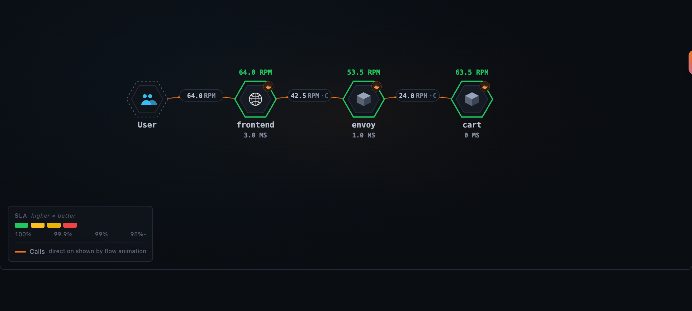
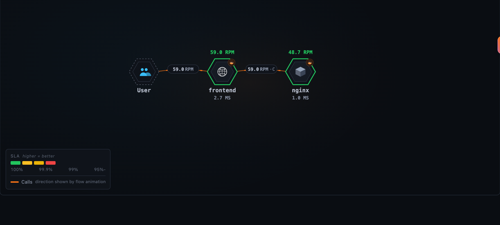
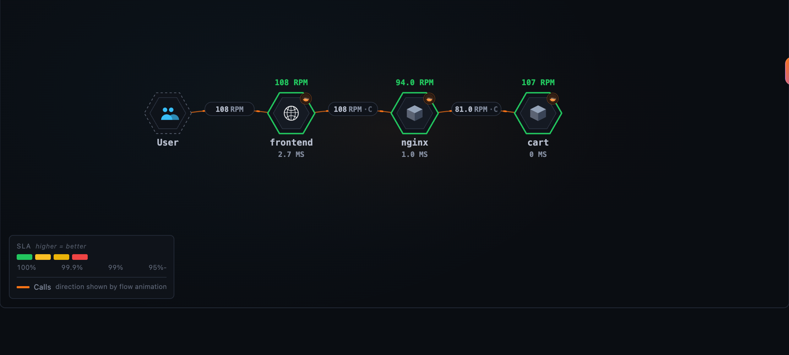
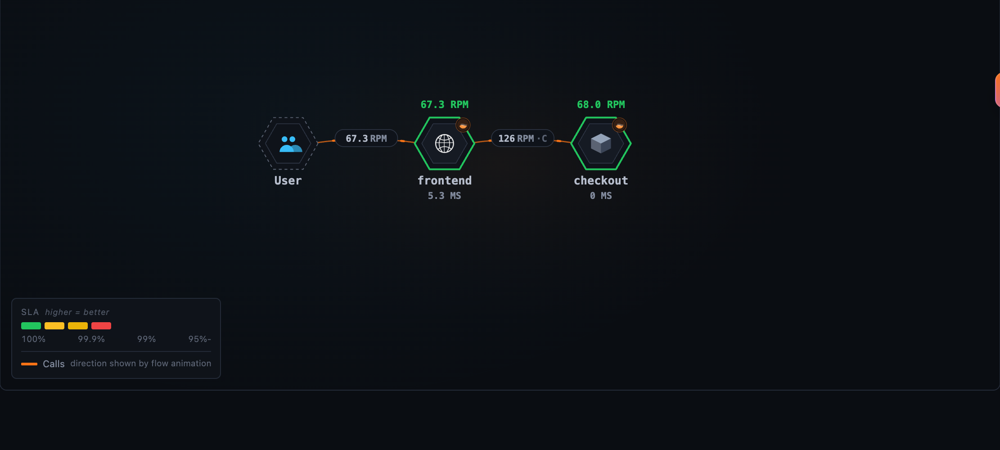
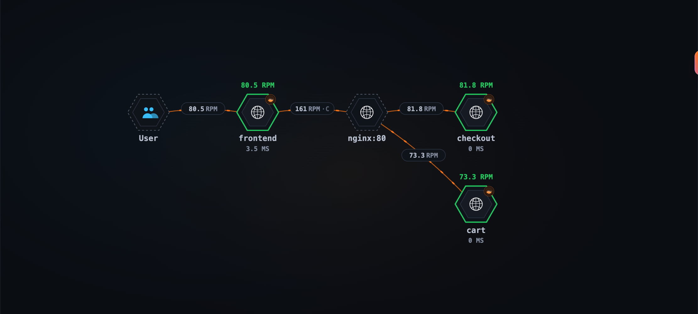
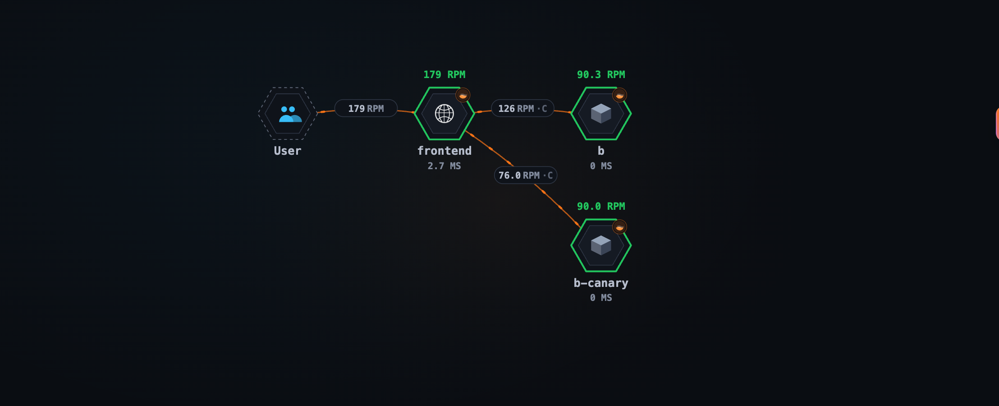
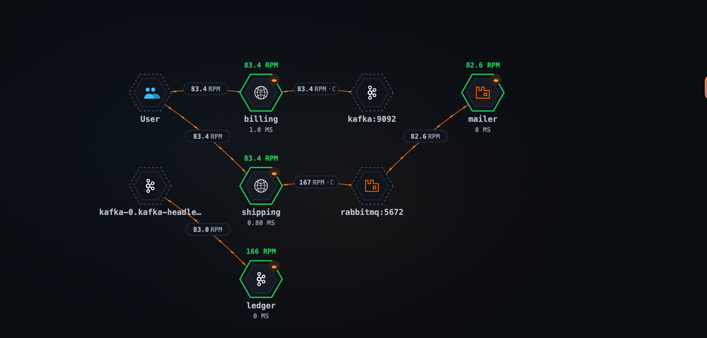
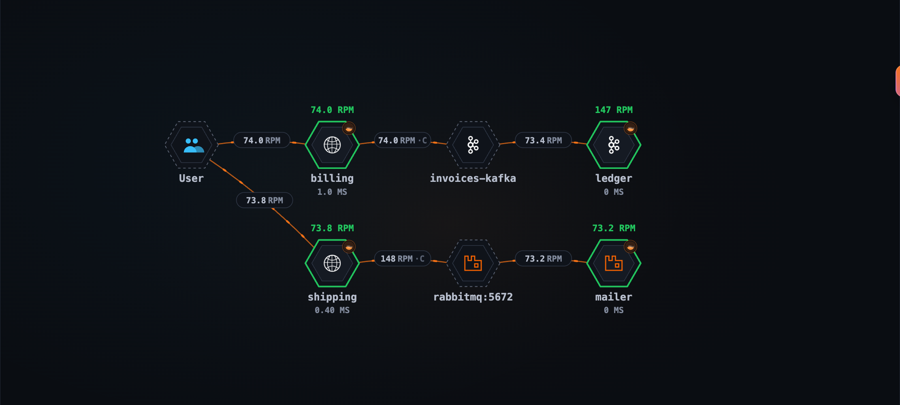
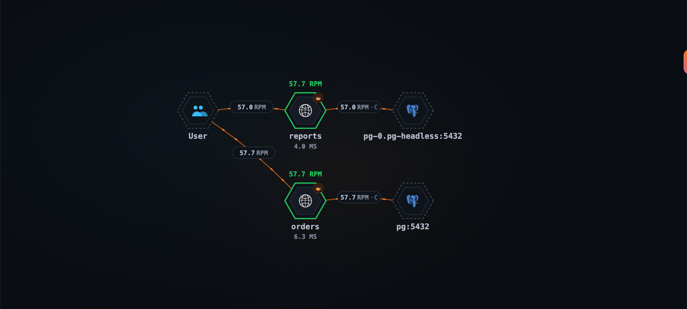
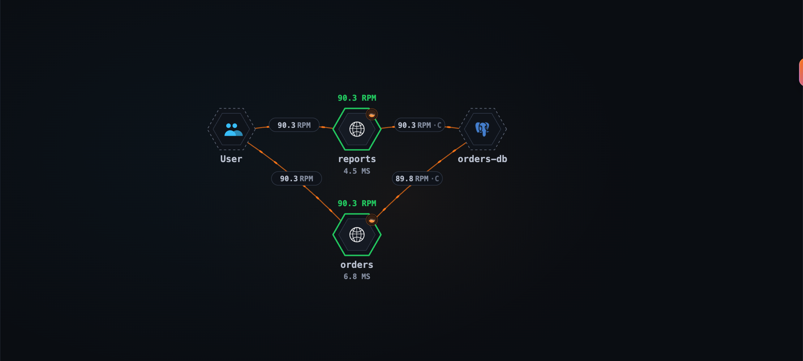

The [previous post](/blog/2026-11-03-otlp-traces-in-skywalking/) showed SkyWalking turning OTLP traces into service
metrics and a topology. In the OpenTelemetry demo the topology came out right with no help, because the demo happens
to avoid the hard cases: its proxy, an Envoy, traces itself, and each of its databases and brokers is reached under
one name. Real systems have more in between: a gateway that does not trace, a canary behind the stable version's
address, a database or broker reached under two names. This post takes each of those, runs it on a laptop, and shows
what the topology looks like before and after the one change that fixes it.

> The features in this post are available since SkyWalking **11.1.0**.

## How SkyWalking names the other end of a call

Everything below follows from one mechanism, so it is worth a minute.

A CLIENT span knows the **address** it dialed, `cart:8080` or `10.0.3.4:8080`, but not which service answered. The
callee's SERVER span knows its own service, and names the caller's span as its parent. The trace analysis pairs the
two and files what it learned under the caller and the address:

```text
frontend  CLIENT  dials cart:8080         span F1
└─ cart   SERVER  parent = F1

learned:  frontend->cart:8080  →  cart
```

From then on, `frontend`'s calls to `cart:8080` land on the `cart` node. One address names one service per caller.
That is the rule each case below bends:

- a **gateway** sits between the two spans of a pair;
- a **canary** shares its address with the stable version;
- a **message broker** answers with no SERVER span at all;
- a **database or broker reached under two names** is two addresses for one thing.

The mechanism, and how the analysis learns and keeps these pairs, is in [Address-named
peers](https://skywalking.apache.org/docs/main/next/en/concepts-and-designs/tal/#address-named-peers).

## Run it yourself

Every case below runs in the [SkyWalking Showcase](https://github.com/apache/skywalking-showcase) as its
`otlp-trace-practices` feature. You need `git`, `make` and Docker with about 6 GB of memory available; the containers
use about 5 GB once running.

```shell
git clone https://github.com/apache/skywalking-showcase.git
cd skywalking-showcase
make deploy.docker FEATURE_FLAGS=single-node,otlp-trace-practices
```

Horizon UI is at http://localhost:8081, login `admin` / `admin`, and the services appear in the OTLP Service layer
within a few minutes. To remove everything:

```shell
make undeploy.docker FEATURE_FLAGS=single-node,otlp-trace-practices
```

The feature runs six small cases side by side, each on its own network and under its own `service.namespace`, so the
OAP names their services `<case>::<service>`, such as `traced-nginx::frontend`:

| Case | Topology |
|---|---|
| `traced-envoy` | `frontend → envoy → cart` |
| `traced-nginx` | `frontend → nginx → cart` |
| `untraced-nginx` | `frontend → [nginx:80] → cart, checkout` |
| `mq` | `billing → invoices-kafka → ledger`, `shipping → rabbitmq:5672 → mailer` |
| `db` | `orders, reports → orders-db` |
| `canary` | `frontend → b`, `frontend → b-canary` |

The services are instrumented with the OpenTelemetry Python auto-instrumentation (Flask, requests, psycopg2,
confluent-kafka, pika), except the two behind the nginx that does not trace, which are Go services with `otelhttp`,
for a reason that case explains. They export OTLP/gRPC straight to the OAP with `service.layer=OTLP_GENERAL` on their
resource, and a `curl` loop per case sends the traffic. The showcase deploys every case with its fix applied; the
screenshots below were taken one case at a time, before and after the fix, so their services carry no case prefix.
Every config below is the one that ran.

## Gateways and proxies

The [Gateways and Proxies](https://skywalking.apache.org/docs/main/next/en/setup/backend/otlp-trace-practices/gateway-overview/)
practice tells which setup fits the gateway in front of your services; each case below links its own page.

### A gateway that traces itself: Envoy

```text
frontend ──▶ envoy:10000 ──▶ cart
```

An Envoy that traces itself reports a SERVER span for the request it receives and, with `spawn_upstream_span`, a
CLIENT span for its call to the upstream. Each hop then pairs from its own two spans, exactly like a service calling a
service:

```yaml
# in the typed_config of the envoy.filters.network.http_connection_manager filter
tracing:
  spawn_upstream_span: true            # a CLIENT span per upstream call; off by default
  provider:
    name: envoy.tracers.opentelemetry
    typed_config:
      "@type": type.googleapis.com/envoy.config.trace.v3.OpenTelemetryConfig
      grpc_service:
        envoy_grpc: { cluster_name: oap }   # a cluster pointing at the OAP's gRPC port, 11800
      service_name: envoy
      resource_detectors:
        - name: envoy.tracers.opentelemetry.resource_detectors.environment
          typed_config:
            "@type": type.googleapis.com/envoy.extensions.tracers.opentelemetry.resource_detectors.v3.EnvironmentResourceDetectorConfig
```

The `environment` resource detector reads `OTEL_RESOURCE_ATTRIBUTES=service.layer=OTLP_GENERAL` from Envoy's
environment, so its spans are analyzed like the services'. One request then reads:

```text
frontend  CLIENT  http.url=http://envoy:10000/cart
└─ envoy  SERVER  (ingress)
   └─ envoy  CLIENT  peer.address=172.19.0.4:8080   (egress, from spawn_upstream_span)
      └─ cart  SERVER
```



Three things to keep:

- **`spawn_upstream_span: true`.** Envoy's default is `false`, and then Envoy reports one span per request: the hop
  from `frontend` pairs, the hop to `cart` does not, and `cart` hangs off nothing. Envoy Gateway turns it on for you.
- **Don't list it in `gateways.yml`.** That file is for gateways that do *not* trace (below). A listed Envoy would
  become a `virtual gateway` node instead of its own service.
- **Give it an instance.** SkyWalking names an instance after the resource's `service.instance.id` (or
  `service.instance`). The Python SDK makes one up; Envoy, nginx's module and the Go SDK do not, and a service
  without one has its service metrics but no instances. Set it with the rest:
  `OTEL_RESOURCE_ATTRIBUTES=service.layer=OTLP_GENERAL,service.instance.id=envoy-0`.

Related docs: [Envoy](https://skywalking.apache.org/docs/main/next/en/setup/backend/otlp-trace-practices/gateway-envoy/).
In the showcase: [`envoy.yaml`](https://github.com/apache/skywalking-showcase/blob/main/deploy/platform/docker/config/otlp-trace-practices/envoy.yaml), and the `traced-envoy` services in [`docker-compose.otlp-trace-practices.yaml`](https://github.com/apache/skywalking-showcase/blob/main/deploy/platform/docker/docker-compose.otlp-trace-practices.yaml).

### nginx with its OpenTelemetry module

```text
frontend ──▶ nginx ──▶ cart (two replicas)
```

nginx's OpenTelemetry module reports **one** SERVER span per request. With `otel_trace_context propagate` it continues
the caller's trace and passes its own span on to the upstream, so `cart`'s SERVER span names nginx's span as its parent.
The shipped rule learns the hop *into* nginx from that span, but nothing says where nginx went next, so the hop out of
it is never learned:



Two small changes connect it. **On nginx**, write the upstream that answered onto the span:

```nginx
# with load_module modules/ngx_otel_module.so; and otel_exporter { endpoint oap:11800; } as usual
otel_service_name nginx;
otel_resource_attr service.layer OTLP_GENERAL;
otel_resource_attr service.instance.id nginx-0;     # the module names no instance of its own

map $upstream_addr $otel_upstream {                    # only when one server answered, no retry
    "~^(?<otel_single_upstream>[^,\s]+)$" $otel_single_upstream;
    default "";
}

server {
    otel_trace         $otel_parent_sampled;
    otel_trace_context propagate;
    otel_span_attr     upstream.address $otel_upstream;
    ...
}
```

```text
nginx  SERVER  parent = frontend's CLIENT span
               upstream.address = 172.19.0.4:8080
└─ cart  SERVER  parent = nginx's span
```

**In the trace analysis**, copy the shipped rule file, `config/tal/otlp-general.yaml` in the OAP
(`/skywalking/config/tal/` in its Docker image), to a file of your own in the same folder, say
`config/tal/otlp-shop.yaml`, or mount it there. Add this block at the end of its SERVER section, the
`if (meta.kind == "SERVER") { ... }` block, and load it with `SW_TRACE_TAL_FILES=otlp-shop`, the file name without its
extension, in place of `otlp-general`, not next to it, or every span counts twice:

```text
// nginx's SERVER span. It also made the call to the upstream.
if (meta.service == "nginx") {
  def upstream = attr("upstream.address")
  if (upstream) {
    prepareNetworkAlias upstream
    def upstream = resolveNetworkAlias(callerScopedAddress(meta.service, upstream))
    def proxied = serviceRelation(CLIENT, meta.service, meta.layer, upstream, "OTLP_GENERAL", component("http"))
    metrics { name "service_relation_client_cpm";       scope proxied; function cpm; value 1 }
    metrics { name "service_relation_client_resp_time"; scope proxied; function avg; value meta.latency }
    metrics { name "service_relation_client_call_sla";  scope proxied; function percent
              match ok }
  }
}
```

`prepareNetworkAlias` is what a CLIENT span normally does: it tells the pairing "I dialed this address". Here nginx's
SERVER span does it on nginx's behalf, and `cart`'s span, whose parent it is, completes the pair:



`upstream.address` is a name we chose, not a semantic convention; whatever you pick, use the same one in nginx and in
the rule. `meta.service` is the name the OAP gives the service, so with services grouped by `service.namespace` it is
the grouped name: the showcase's rule compares `traced-nginx::nginx`.

The `map` leaves a retried request's upstream empty, because a retry lists every server it tried and the pair
could not tell which one answered.

Related docs: [nginx with the OpenTelemetry module](https://skywalking.apache.org/docs/main/next/en/setup/backend/otlp-trace-practices/gateway-nginx/#with-the-opentelemetry-module).
In the showcase: [`nginx-traced.conf`](https://github.com/apache/skywalking-showcase/blob/main/deploy/platform/docker/config/otlp-trace-practices/nginx-traced.conf), the rule file [`otlp-trace-practices.yaml`](https://github.com/apache/skywalking-showcase/blob/main/deploy/platform/docker/config/otlp-trace-practices/otlp-trace-practices.yaml), and the `traced-nginx` services
in [`docker-compose.otlp-trace-practices.yaml`](https://github.com/apache/skywalking-showcase/blob/main/deploy/platform/docker/docker-compose.otlp-trace-practices.yaml).

### A gateway that does not trace

```text
frontend ──▶ nginx ──▶ /cart     → cart
                   └──▶ /checkout → checkout
```

An ingress, a cloud load balancer or an nginx without tracing emits no spans. `frontend` dials `nginx`, and the next
span is `cart`'s or `checkout`'s, naming `frontend`'s span as its parent. So the pair learns `frontend->nginx:80 → cart`,
and a moment later `frontend->nginx:80 → checkout`, each overwriting the other. In the lab, the gateway is gone and
every call lands on whichever service answered last:



List the gateway in `config/gateways.yml`, as the callers name it, and keep the callers' `Host` on the way through:

```yaml
gateways:
  - name: shop-gateway
    instances:
      - host: nginx     # as frontend's spans name it: http://nginx/...
        port: 80
```

```nginx
location /cart     { proxy_set_header Host $host; proxy_pass http://cart:8080; }
location /checkout { proxy_set_header Host $host; proxy_pass http://checkout:8080; }
```

A listed address is never paired. `frontend`'s calls end on a `virtual gateway` node, and each service behind it draws
its own edge from the gateway, read from the `Host` it received:



The second half, the gateway's edge to each service, depends on the address the service's SERVER span says it was
dialed at, and here the SDKs differ:

```text
Go otelhttp          cart SERVER  server.address=nginx                     → nginx:80, the listed gateway
Python Flask (WSGI)  cart SERVER  server.address=nginx  server.port=8080   → nginx:8080, not listed
```

A `Host` without a port, as nginx's `$host` passes it, is read as port 80, the port `gateways.yml` assumes. Go's
`otelhttp` takes the host and the port from the `Host` header and leaves the port out when the header has none. The
Python WSGI instrumentation (0.66b2) takes the host from the `Host` header but the port from the port the application
itself listens on, with the old and the stable HTTP conventions alike, so a Flask service behind this gateway reports
`nginx:8080` and draws no edge from it; only `frontend → [nginx:80]` remains. That is why `cart` and `checkout` are Go
services in this case. Before relying on the gateway's edges, look at what your services' SERVER spans report.

Related docs: [Gateways Without Instrumentation](https://skywalking.apache.org/docs/main/next/en/setup/backend/otlp-trace-practices/gateway-without-instrumentation/).
In the showcase: [`nginx-untraced.conf`](https://github.com/apache/skywalking-showcase/blob/main/deploy/platform/docker/config/otlp-trace-practices/nginx-untraced.conf), [`gateways.yml`](https://github.com/apache/skywalking-showcase/blob/main/deploy/platform/docker/config/otlp-trace-practices/gateways.yml), and the `untraced-nginx` services in
[`docker-compose.otlp-trace-practices.yaml`](https://github.com/apache/skywalking-showcase/blob/main/deploy/platform/docker/docker-compose.otlp-trace-practices.yaml).

## Canary releases

```text
frontend ──▶ b:8080 (a router that emits no spans)
                 ├─ x-canary: v2 → b-canary
                 └─ otherwise    → b
```

A canary is a second version behind the same address. Here a router that does not trace sends requests carrying
`x-canary: v2` to `b-canary` and the rest to `b`, the way Istio routes on a header with the sidecars' tracing off.
`frontend` dials `b:8080` either way, so both kinds of call pair under one row, `frontend->b:8080`, which names `b`
one moment and `b-canary` the next. Every call lands on the service the address was last paired with. In the lab,
over one minute:

| | `frontend → b` edge | `frontend → b-canary` edge | `b` served | `b-canary` served |
|---|---|---|---|---|
| shipped rule | 230 | none | 115 | 115 |
| with the rule below | 115 | 115 | 115 | 115 |



Only the caller's span can tell the two kinds of call apart, so put the version into the address it dialed. In your
copy of the rule file, after the peer is named and after the line that adds `:80` to a gateway dialed without a port,
and before `prepareNetworkAlias`:

```text
if (peer && !isGateway(peer)
    && attr("http.request.header.x-canary", "http.request.header.x_canary") == "v2") {
  def peer = peer + "(v2)"
}
```

The canary's calls are then `frontend->b:8080(v2) → b-canary`, the others `frontend->b:8080 → b`, and each edge counts
its own calls:


Three details the lab turned up:

- **The header has to be on the CLIENT span**, which the SDKs record only when asked. For the Python `requests`
  instrumentation: `OTEL_INSTRUMENTATION_HTTP_CAPTURE_HEADERS_CLIENT_REQUEST=x-canary`.
- **Python spells it differently.** The semantic conventions keep the header's dashes,
  `http.request.header.x-canary`; the Python instrumentation turns them into underscores,
  `http.request.header.x_canary`. The rule reads both.
- **The value is a list**, `["v2"]`; the OAP joins a list with `,`, so a single header reads as `v2`.

`!isGateway(peer)` leaves a call to a listed gateway as it is, since `nginx:80(v2)` would no longer match
`gateways.yml`. Match only the values you route on: appending any value as it comes makes a new row per value.

Two other shapes, not run here:

- **A traced gateway that dials each version at its own address** needs nothing. `gateway->10.0.1.5:8080 → b` and
  `gateway->10.0.2.7:8080 → b-canary` are two rows, whether the split is by header, weight or blue/green. Prefer this
  one where you can.
- **A traced gateway that dials both versions at one address**, a router behind it splitting them, needs the same rule
  on the gateway's own CLIENT spans, with `meta.service == "<gateway>"` in place of `!isGateway(peer)`, and the
  gateway recording the header on its CLIENT span.

A split by weight leaves nothing on the caller's span to tell the versions apart: trace the gateway so it dials each
version at its own address, or report the canary under the same `service.name` with its own `service.instance.id`, so
its calls count as `b`'s and its instances tell the versions apart.

Related docs: [Canary Releases](https://skywalking.apache.org/docs/main/next/en/setup/backend/otlp-trace-practices/gateway-canary/).
In the showcase: [`nginx-canary.conf`](https://github.com/apache/skywalking-showcase/blob/main/deploy/platform/docker/config/otlp-trace-practices/nginx-canary.conf), the rule file
[`otlp-trace-practices.yaml`](https://github.com/apache/skywalking-showcase/blob/main/deploy/platform/docker/config/otlp-trace-practices/otlp-trace-practices.yaml), and the `canary` services in
[`docker-compose.otlp-trace-practices.yaml`](https://github.com/apache/skywalking-showcase/blob/main/deploy/platform/docker/docker-compose.otlp-trace-practices.yaml).

## Message queues

A producer and a consumer are both clients of the broker. There is no SERVER span to pair, so the broker is named
from each span's own attributes, and the two edges, `producer → broker` and `broker → consumer`, meet only where both
sides spell the broker the same way.

The lab runs a Kafka broker reached at two addresses, its Service `kafka:9092` and its own name
`kafka-0.kafka-headless:9092`, and a RabbitMQ:

| Service | Client | Connects with |
|---|---|---|
| `billing` (producer) | confluent-kafka | `bootstrap.servers=kafka:9092,kafka-0.kafka-headless:9092` |
| `ledger` (consumer) | confluent-kafka | `bootstrap.servers=kafka-0.kafka-headless:9092,kafka:9092` |
| `shipping` (producer) | pika | `ConnectionParameters(host="rabbitmq", port=5672)` |
| `mailer` (consumer) | pika | the same |

confluent-kafka names the broker by the **first** `bootstrap.servers` entry, on both sides; pika by the host and port
it was given:

```text
billing  PRODUCER  messaging.system=kafka     server.address=kafka                   server.port=9092
ledger   CONSUMER  messaging.system=kafka     server.address=kafka-0.kafka-headless  server.port=9092
shipping PRODUCER  messaging.system=rabbitmq  net.peer.name=rabbitmq                 net.peer.port=5672
mailer   CONSUMER  messaging.system=rabbitmq  net.peer.name=rabbitmq                 net.peer.port=5672
```

RabbitMQ meets on one node. Kafka is one broker drawn as two, and the two halves of each message never meet:



Either list the same bootstrap entry first in every client, or name the broker in `config/server-clusters.yml`, every
spelling the clients report:

```yaml
clusters:
  - name: invoices-kafka
    members:
      - kafka-0.kafka-headless:9092   # the broker's own name
    aliases:
      - kafka:9092                    # its Service
```



What to expect from other clients, from the [message queue
practices](https://skywalking.apache.org/docs/main/next/en/setup/backend/otlp-trace-practices/message-queue/):

- **No address at all.** The OpenTelemetry Java and .NET agents, kafkajs, kafka-python and the Go auto-instrumentation
  (for `segmentio/kafka-go`) report no Kafka broker address, so every Kafka cluster they reach is one node named
  `kafka`; nothing in `server-clusters.yml` can split it. The Java agent's RabbitMQ spans land on `rabbitmq` the same
  way.
- **One side only.** The RabbitMQ .NET client names its endpoint when it publishes, but its `deliver` span names none,
  so its consumer side stays on `rabbitmq`.
- **No direct edge.** The topology draws `producer → broker → consumer`, never `producer → consumer`. Which consumer read
  which producer's messages shows in a trace only when the consumer continues the producer's trace, as pika's does here;
  confluent-kafka's consumer starts a trace of its own.

One more thing the lab shows: a client that reports a message twice is counted twice. The pika instrumentation
(0.66b2) reports each publish as two nested PRODUCER spans, so `shipping → rabbitmq` shows twice the messages sent.
confluent-kafka's consumer reports a `recv` CONSUMER span with the `process` span under it; only `process` names the
broker, so the edge from the broker is right, but both count as requests of `ledger`, which shows twice its rate.

Related docs: [Message Queue](https://skywalking.apache.org/docs/main/next/en/setup/backend/otlp-trace-practices/message-queue/), with what each client reports.
In the showcase: [`server-clusters.yml`](https://github.com/apache/skywalking-showcase/blob/main/deploy/platform/docker/config/otlp-trace-practices/server-clusters.yml), and the `mq` services, Kafka and RabbitMQ in
[`docker-compose.otlp-trace-practices.yaml`](https://github.com/apache/skywalking-showcase/blob/main/deploy/platform/docker/docker-compose.otlp-trace-practices.yaml).

## Databases and caches

A database answers with no SERVER span either, so it is named after the address the client reports. Two services
reaching one PostgreSQL by two names:

| Service | Connects to | Its span reports |
|---|---|---|
| `orders` | `pg:5432` (the Service) | `net.peer.name=pg`, `net.peer.port=5432` |
| `reports` | `pg-0.pg-headless:5432` (the server's own name) | `net.peer.name=pg-0.pg-headless`, `net.peer.port=5432` |



The same file names them as one:

```yaml
clusters:
  - name: orders-db
    members:
      - pg-0.pg-headless:5432   # the server's own name
    aliases:
      - pg:5432                 # its Service
```



`members` are single nodes, `aliases` names for the whole cluster; both are renamed. Addresses are compared as
strings: nothing is resolved and no default port is assumed, so copy into the file exactly what the spans report,
every spelling of it. Look at the address-named nodes in the topology, or search the spans in TraceQL.

**Two systems behind one address.** The rename goes by address alone, so if a load balancer `data-lb.internal` fronts
both PostgreSQL and Redis, and both clients report the bare host, as clients that leave out a default port do, the
Redis calls are renamed to `orders-db` too. Give the cluster the system as a kind, and pass the span's system in your
copy of the rule file:

```yaml
clusters:
  - name: orders-db
    kinds: [postgresql]         # as the clients report db.system.name / db.system
    aliases: [data-lb.internal]
```

```text
def cluster = findServerClusterName(peer, attr("db.system.name", "db.system", "messaging.system.name", "messaging.system"))
```

The [database and cache
practices](https://skywalking.apache.org/docs/main/next/en/setup/backend/otlp-trace-practices/database-and-cache/#renaming-a-cluster-only-for-its-own-system)
list the three calls to change together.

Related docs: [Database and Cache](https://skywalking.apache.org/docs/main/next/en/setup/backend/otlp-trace-practices/database-and-cache/), with what each client reports.
In the showcase: [`server-clusters.yml`](https://github.com/apache/skywalking-showcase/blob/main/deploy/platform/docker/config/otlp-trace-practices/server-clusters.yml), and the `db` services and PostgreSQL in [`docker-compose.otlp-trace-practices.yaml`](https://github.com/apache/skywalking-showcase/blob/main/deploy/platform/docker/docker-compose.otlp-trace-practices.yaml).

## Checklist

| In front of the callee | Do | Topology |
|---|---|---|
| A gateway that traces itself (Envoy) | `spawn_upstream_span: true`, `service.layer=OTLP_GENERAL` on its spans | `caller → envoy → service` |
| A proxy with one span per request (nginx module) | `upstream.address` on its span, one block in your rule file | `caller → nginx → service` |
| A gateway that does not trace | list it in `gateways.yml`, keep the `Host` | `caller → [gateway] → service` |
| A canary a traced gateway dials at its own address | nothing | `gateway → b`, `gateway → b-canary` |
| A canary behind one address | a header rule on the CLIENT spans | `caller → b`, `caller → b-canary` |
| A broker or database reached under several names | `server-clusters.yml`, every spelling the spans report | one node |
| Two systems behind one address | `kinds` on the cluster, the system passed in your rule file | one node per system |

## Learn more

- [Gateways and Proxies](https://skywalking.apache.org/docs/main/next/en/setup/backend/otlp-trace-practices/gateway-overview/),
  with the pages for [Envoy](https://skywalking.apache.org/docs/main/next/en/setup/backend/otlp-trace-practices/gateway-envoy/),
  [nginx](https://skywalking.apache.org/docs/main/next/en/setup/backend/otlp-trace-practices/gateway-nginx/),
  [gateways without instrumentation](https://skywalking.apache.org/docs/main/next/en/setup/backend/otlp-trace-practices/gateway-without-instrumentation/)
  and [canary releases](https://skywalking.apache.org/docs/main/next/en/setup/backend/otlp-trace-practices/gateway-canary/)
- [Message Queue](https://skywalking.apache.org/docs/main/next/en/setup/backend/otlp-trace-practices/message-queue/)
  and [Database and Cache](https://skywalking.apache.org/docs/main/next/en/setup/backend/otlp-trace-practices/database-and-cache/)
  practices, with what each agent reports
- [Server clusters](https://skywalking.apache.org/docs/main/next/en/setup/backend/server-clusters/) and
  [uninstrumented gateways](https://skywalking.apache.org/docs/main/next/en/setup/backend/uninstrumented-gateways/)
- [Trace Analysis Language](https://skywalking.apache.org/docs/main/next/en/concepts-and-designs/tal/), for the rule
  functions used above
