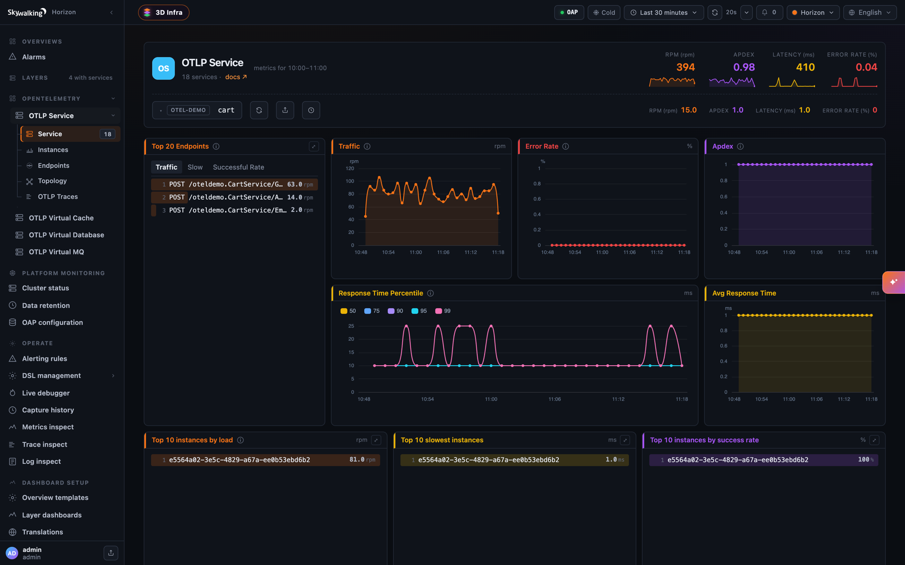
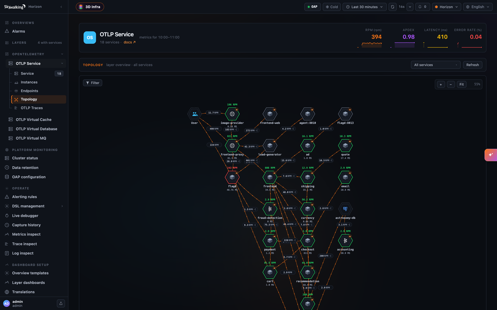

SkyWalking APM 11.1.0 is released. Go to [downloads](/downloads) page to find release tars.

### Metrics and Topology from OTLP Traces

Applications instrumented with the OpenTelemetry SDKs no longer need a SkyWalking agent for service dashboards, topology and trace search. OAP stores OTLP traces as they arrive, and the new [Trace Analysis Language (TAL)](/docs/main/v11.1.0/en/concepts-and-designs/tal/) turns every span into service, instance and endpoint metrics, a topology, and dashboards for the databases, caches and message queues the services call. Point the OTLP exporter at the OAP, set `service.layer=OTLP_GENERAL` in the resource attributes, and the services show up under the new `OTLP_GENERAL` layer, with metrics named and counted the same way as the agent-based `GENERAL` layer.

Read [OpenTelemetry Traces in SkyWalking](/blog/2026-11-03-otlp-traces-in-skywalking/) for a one-command quick start with the OpenTelemetry Astronomy Shop, and the [OTLP trace](/docs/main/v11.1.0/en/setup/backend/otlp-trace/) and [trace analyzer](/docs/main/v11.1.0/en/setup/backend/trace-analyzer/) docs for your own applications.

### Also in this release

* **AI agent conversations** — the `AI_AGENT` layer stores what the AI Sessionizer lands and serves each conversation as one document, with the agent's token, MCP and Claude Code metrics.
* **Server clusters** — show a message broker, a database or a cache that clients reach at more than one address as one service. See [server clusters](/docs/main/v11.1.0/en/setup/backend/server-clusters/).
* **BanyanDB credentials and TLS CA hot-reload**, without restarting OAP.
* **OpenTelemetry Collector `hostmetrics`** as a source for Linux and Windows host and process monitoring.
* **LLM-as-judge** evaluation for GenAI, with the results queryable in Horizon UI.
* Many metric corrections in the MAL rules for Kafka, RabbitMQ, PostgreSQL, MySQL, Kong, APISIX, Windows and Zabbix.

### Upgrade notes

* OTLP traces are stored natively by default (`otlpTraceStorage: otlp`). Set `otlpTraceStorage: zipkin` to keep the previous conversion to Zipkin.
* Windows monitoring through windows_exporter requires windows_exporter `0.29.0` or later.
* The `SpanListener` SPI's `onOTLPSpan` / `onNativeOTLPSpan` gain a `serviceName` parameter; an implementation of the old signature is no longer called.
* A customized `mesh.oal` needs `filter(... >= 0)` on the sidecar internal latency metrics, as the shipped one has, or the new `-1` values are averaged in.
* The corrected Kafka, RabbitMQ, PostgreSQL and Zabbix metrics keep their old values before the upgrade, so those charts step at the upgrade.

#### Project

* Add the Envoy project's NOTICE to `NOTICE` and to the binary distribution's NOTICE, for the Envoy proto files bundled in `receiver-proto`.

#### OAP Server

* Add customizable LLM-as-judge support for AI evaluation, with OpenAI-compatible endpoint / model / API key configuration, and persist the results as queryable `GenAIEvaluationRecord` rows.
* Hot-reload the BanyanDB credentials from a new `secretsManagementFile` in `bydb.yml` (`SW_STORAGE_BANYANDB_SECRETS_MANAGEMENT_FILE`), as the Elasticsearch storage does, so a rotation by a tool such as Vault applies without restarting OAP or interrupting in-flight requests. An incomplete file sends no credentials, so a mistake fails visibly with `UNAUTHENTICATED`.
* Hot-reload the BanyanDB TLS trust CA at `sslTrustCAPath`: a change rebuilds the gRPC channel, created before the old one is released, so a rotation no longer costs an outage. The new channel is not health-checked before the swap; the storage doc describes the old+new CA overlap procedure.
* Fix `MultipleFilesChangeMonitor` silently disabling every file watch in the OAP: a `ConcurrentModificationException` during a scan cancelled the shared scheduler task for good, after which no secrets file, keystore or TLS certificate was reloaded again. The registry is now copy-on-write.
* Fix `MultipleFilesChangeMonitor` ignoring its watching period, so every watch re-read its files every 200ms. Rotated files are now picked up within the configured period, 10 seconds for every shipped watch.
* Add BanyanDB trace tail sampling metrics to the BanyanDB self-observability layer (`otel-rules/banyandb/banyandb-trace-sampling.yaml`), covering the sampler plugin chain's pipeline, decision, fail-open and retention metrics. They stay absent on a cluster with no sampler configured.
* Fix a cross-rule `CounterWindow` key collision in the v2 MAL engine: two rules reading one counter, filtering it with `tagEqual(...)` and summing the filtered label away computed `rate()` / `increase()` / `irate()` against each other's values. About 25 shipped rules were affected, among them ActiveMQ GC counts, MySQL `commands_*` / `tps`, the GenAI gateway token rates, four Envoy `cluster_*` counters, APISIX bandwidth and BanyanDB `network_recv` / `network_sent`. The window is now keyed by rule, counter name and labels; no rule changes were needed.
* Fix `meter_rabbitmq_node_outgoing_messages_total` counting auto-ack `basic.get` deliveries twice.
* Add AI agent conversations landed by the AI Sessionizer: the `AI_AGENT` layer, the `lal/ai-agent.yaml` rule that stores Session Data and Session Flow files in a new BanyanDB group `recordsAIAgent`, the `ai-agent-conversation` module that folds a conversation into one `asz.view` document, the `listConversations` GraphQL query, and two streamed HTTP routes for the view and the session files. The document carries the session's workspace changes and provider bodies, and the default-on `otel-rules/ai-agent/` rule set takes the agent runtime's metrics from the Sessionizer and from Claude Code's own exporter. Ingest and reads are bounded by `maxFileBytes` (15 MiB), `readWindow` (16) and `maxResponseBytes` (100 MiB).
* Support querying Zipkin traces from the BanyanDB cold stage through the Zipkin HTTP API with a new optional `coldStage` parameter; the by-id lookups also gain `endTs` and `lookback`. Existing Zipkin clients keep working unchanged.
* BanyanDB: a query without a time range now covers everything the hot/warm stages retain instead of the last 24 hours, so trace lookups by id, including Zipkin and TraceQL, find traces older than a day. `queryTraces` now rejects a condition with neither `queryDuration` nor `traceId`.
* Fix MySQL, PostgreSQL and H2 reading only the first day's table of a time range shorter than a day that crosses midnight, which left the newer day's rows out of every time-ranged read after each midnight.
* Fix a minute of metrics on BanyanDB losing the points of an earlier persistence round, seen as the first minute of a burst of OTLP metrics vanishing right after boot. A persistence round now completes only when every write of it is acknowledged, and `endOfFlush` forces the BanyanDB measure bulk out.
* Fix BanyanDB bulk writes leaving futures pending when a write fails to build, so persistence rounds and runtime-rule removal end with an error instead of waiting indefinitely.
* Apply `httpMaxRequestHeaderSize` (and the AWS Firehose receiver's `maxRequestHeaderSize`) to HTTP/2 as well, the protocol the OTLP and gRPC-Web clients use.
* Add a `none` provider to the `ai-agent-conversation` module (`SW_AI_AGENT_CONVERSATION=none`) to turn the AI agent conversation feature off.
* Fix the OpenTelemetry receiver folding a request that carries several minutes of points into one minute; a request is now analysed a minute at a time.
* Fix the runtime-rule sync tearing down and reloading every bundled MAL and LAL rule on its first pass after each boot, which dropped up to a persistence round of metrics from each rule set on every restart.
* Open every port that takes requests only after the boot is complete, through a new `ModuleProvider.notifyBootCompleted` hook, so readiness probes that check a port mean what they say.
* Fix the Elasticsearch storage failing every event query with a layer condition (`number_format_exception`), which broke Horizon UI's per-service events popout.
* **Store OTLP traces natively.** `receiver-otel` gains `otlpTraceStorage: otlp`, the new default, which keeps each span as the `ResourceSpans` it arrived in (BanyanDB group `otlpTrace`), and the TraceQL module gains an `/otlp` datasource that serves them to Grafana Tempo. `otlpTraceStorage: zipkin` keeps the previous conversion to Zipkin.
* Bring the TraceQL module closer to the Tempo API: span sets list only the matched spans, `serviceStats` is filled, `span.http.status_code` filters, the tag endpoints honour `scope` and `limit`, tag lookups filtered by `q` narrow Grafana's dropdowns, and `/api/metrics/query_range` and `/api/metrics/query` answer `501 Not Implemented` instead of a `200` Grafana cannot parse.
* Refuse unsupported TraceQL with `400` instead of dropping the predicate and returning unfiltered traces, and leave out a trace none of whose spans satisfies every condition. Every search-result span carries a `status` attribute.
* Support the OpenTelemetry Collector `hostmetrics` receiver as an alternative source for Linux and Windows host monitoring, mapped to the same `meter_vm_*` / `meter_win_*` metrics plus a few only it provides, and add per-process metrics in the default-on `process-hostmetrics-linux` and `process-hostmetrics-windows` rules. Reference Collector configurations are in the docs.
* Windows monitoring through windows_exporter now requires windows_exporter `0.29.0` or later: the memory rules read the `memory` collector, since `0.31.0` removed the metrics they read. Also fix `meter_win_cpu_total_percentage` counting overlapping CPU modes twice.
* Fix no Linux or Windows host service being created from an OpenTelemetry Collector `0.127.0` or later, which sends the host as `server.address`.
* AI agent conversations adopt AI Sessionizer `130601c`: MCP server calls are stored and listed under `tool_executions`, and the new `otel-rules/ai-agent/mcp_endpoint.yaml` gives one endpoint per MCP server and tool with call, outcome and duration metrics.
* Fix the Elasticsearch `BulkProcessor` treating a bulk write as successful whenever the HTTP status was 200, even when items were rejected, such as a 429 when an index goes `read_only_allow_delete` at the flood-stage disk watermark. Rejected requests now fail, summarized in one ERROR line per `_bulk` request; one chunk's result no longer completes the whole flush, and a request whose bulk failed to build no longer hangs a persistence round.
* AI agent conversations adopt AI Sessionizer `6691c36` and can withhold what the runtime sent the model: the `hide` setting (`SW_AI_AGENT_CONVERSATION_HIDE`) masks the system prompt and the tool schemas from every reader as a conversation is served, while the storage keeps every file whole.
* Fix endpoints registered from logs, virtual MQ spans, cross-thread references and Cilium Hubble missing from `findEndpoint` queried with a time range, as they never set `last_ping`.
* Add `alarm.default.httpTimeout` (`SW_ALARM_HTTP_TIMEOUT`, 12 seconds), a deadline covering the whole HTTP request of every HTTP-based alarm hook, so an endpoint that stalls while sending the body can no longer hold the alarm delivery thread.
* AI agent conversations adopt AI Sessionizer `aa67971`: a segment is an activity window, and the document drops the fields the Sessionizer stopped writing.
* AI agent conversations show where a model call's history changed, as the `history.change` steps the AI Sessionizer draws.
* AI agent conversations follow the AI Sessionizer's id escaping and round rules.
* **Add the Trace Analysis Language (TAL)**, a compiled DSL in the new `trace-analyzer` module that turns OTLP spans into metrics, topology and records, in both OTLP trace storage modes and ahead of the receiver's head sampling. The shipped `tal/otlp-general.yaml` analyzes the spans whose resource carries `service.layer=OTLP_GENERAL` into the new `OTLP_GENERAL` layer, named and counted like the agent path's `core.oal` metrics, plus `OTLP_VIRTUAL_DATABASE`, `OTLP_VIRTUAL_CACHE` and `OTLP_VIRTUAL_MQ` for what the services call, a `User` node and slow statements. An address-named peer folds onto its service by pairing a client span with its child server span, which learns an alias keyed by the caller and the address it dialed; an address in `gateways.yml` is drawn as a `VIRTUAL_GATEWAY` node. New settings `talFiles`, `dedupWindow`, `dedupCapacity` and `pairingSamplePercent`.
* Fix the `max` and `min` meter functions keeping the first value when merging, and `latestLabeled` dropping label sets, whenever an entity's samples arrived in more than one batch.
* Fix the OTLP/HTTP JSON trace endpoint decoding the hex `traceId`, `spanId` and `parentSpanId` as base64.
* Fix the heatmap query failing on a meter histogram bucket bound beyond an int, such as an OTel histogram's `+Inf` bucket.
* Cut the slow statements a LAL `SlowSQL` output writes to the 2000 characters of the `top_n_database_statement` column, as the agent path does.
* Fix a UI template update on BanyanDB leaving a disabled template disabled; `PUT /ui-management/templates` now re-enables it on every storage.
* Fix Elasticsearch metric reads locating indices by `superDatasetDayStep` while metrics are rolled by `dayStep`, which returned nothing or part of the range when the two differ.
* Read the Kubernetes and Istio metadata used by Envoy ALS `k8s-mesh`, the eBPF access log, MAL `retagByK8sMeta` and the MAL process names in the background instead of on the analysis thread, so a slow or unreachable API server can no longer hold gRPC handler threads and exhaust OAP's memory. MAL waits up to `core.default.malMetadataReadTimeout` (2 seconds); new settings tune the read queues, refresh, cache and not-found retry periods, and failed reads log one summary instead of a line each.
* Fix the Elasticsearch Zipkin trace search listing over 20,000 daily index names when the query starts at or before the epoch.
* Fix Elasticsearch reads of a metric a peer OAP reinstalls without a schema change, with `logicSharding` enabled.
* Fix a service instance dropping out of a time-ranged instance list when a record carrying an older minute updates it; `InstanceTraffic` now keeps the latest `last_ping`.
* Fix eBPF access-log timestamps losing sub-second precision, which quantized short mesh HTTP latency to 0 or 1000ms.
* Fix the Envoy ALS sidecar internal latencies dropping whole seconds, and leave the internal response latency out when the access log lacks the timing it is computed from.
* Sync the Envoy access log proto with Envoy v1.40.0, and leave out the internal latencies the access log cannot measure, such as of a retried or hedged request; the adapters report them as `-1` and `mesh.oal` filters them out with `filter(... >= 0)`.
* Fix OAL comparison filters on `long` or `double` fields, such as `filter(sideCar.internalRequestLatencyNanos >= 0)`, failing to compile.
* Add `ZIPKIN` to the GenAI evaluation record's `traceRef.type`, so the type names the store holding the judged span.
* Fix the Zabbix receiver dropping the sub-second part of agent sample times.
* Fix expired records never being dropped on receipt in `RecordStreamProcessor`.
* Fix Kong and APISIX latency percentiles being about 1000 times too high.
* Fix the service topology drawing a service as a different one when its name equals a network address alias.
* Add `receiver-otel.otlpServiceGroupKeys` (`SW_OTEL_RECEIVER_OTLP_SERVICE_GROUP`) to group OTLP services as `group::name` by a resource attribute such as `service.namespace` or `k8s.namespace.name`, in the trace analysis, the stored spans and the OTLP logs. This changes the `SpanListener` SPI: `onOTLPSpan` / `onNativeOTLPSpan` gain a `serviceName` parameter.
* Fix pprof task log records treating the task duration as seconds instead of minutes.
* Fix the Kafka broker `request_queue_time_ms`, `remote_time_ms`, `response_queue_time_ms` and `response_send_time_ms` metrics reporting observation rate instead of latency.
* Fix the Kafka broker throughput and topic metrics: per-topic bytes in read bytes out, the broker totals were counted twice, the topic metrics carried an extra `topic=""` series, and the network processor idle percent was a rate.
* Fix the RabbitMQ singleblock allocator meters reading multiblock carriers.
* Fix the PostgreSQL temporary-files rate reading temp bytes.
* Fix the Zabbix agent filesystem usage percentage reading inode usage; it now reads `vfs.fs.size[/,pused]`, which is added to the required item keys.
* AI agent conversations read a tool call as its arguments, as the AI Sessionizer does.
* Add the `OTLP_MESH` layer for service mesh sidecars that report over OTLP, such as Istio's Envoy; their spans are stored and searchable but not analyzed.
* The OTLP service catalog and the stored spans keep each service's `service.layer` (`UNDEFINED` when absent), and a TraceQL `q` on `resource.service.layer` alone lists the services from the catalog.
* Write a network address alias only when its mapping changes or every five minutes, about twelve writes an hour for a stable alias instead of about 140.
* Fix the RabbitMQ multiblock and multiblock-pool unused meters reporting the whole carriers size.
* Fix the RabbitMQ node publisher count, which now reads `rabbitmq_global_publishers`, counted correctly from RabbitMQ 3.10.11 and 3.11.3.
* Fix the MySQL max-connections connection-errors metrics filtering a mistyped label, which left the chart empty.
* **Add server clusters**, `server-clusters.yml` and the dynamic configuration item `core.default.serverClusters`, to show a broker, a database or a cache reached at several addresses as one service, in the native trace analysis and in TAL through `findServerClusterName`. Empty by default.
* Add HTTP alarm hook delivery self-observability metrics, `alarm_http_delivery_total`, `alarm_http_delivery_status_total` and `alarm_http_delivery_latency_seconds`, with the reason a delivery failed, plus OAP self-observability MAL rules and Grafana charts. A 2xx response carrying a DingTalk, WeCom, Feishu or WeLink error code is now logged as a failure.

#### UI

* Add a Virtual GenAI evaluation-record page and evaluation-score chart in Horizon UI, showing each evaluation's result, level, reason, judge model, timestamp and trace link, and the `gen_ai_model_evaluation_score_ppm` trend.

#### Documentation

* Fix the Windows monitoring doc's example Collector configuration, which used the removed `logging` exporter.
* Document the BanyanDB trace tail sampling metrics in the BanyanDB self-observability dashboard catalog.
* Rename Envoy AI Gateway to Agent Router in the monitoring docs; the layer, routing tag, rule file and metric names are kept.
* Give the AI agent metrics a catalog naming the source of each, the AI Sessionizer or Claude Code's own exporter.
* Fix the OpenTelemetry receiver page's metrics handler name, `otlp-metrics`, and its description of which rule-file nodes it reads.

All issues and pull requests are [here](https://github.com/apache/skywalking/issues?q=milestone:11.1.0)
