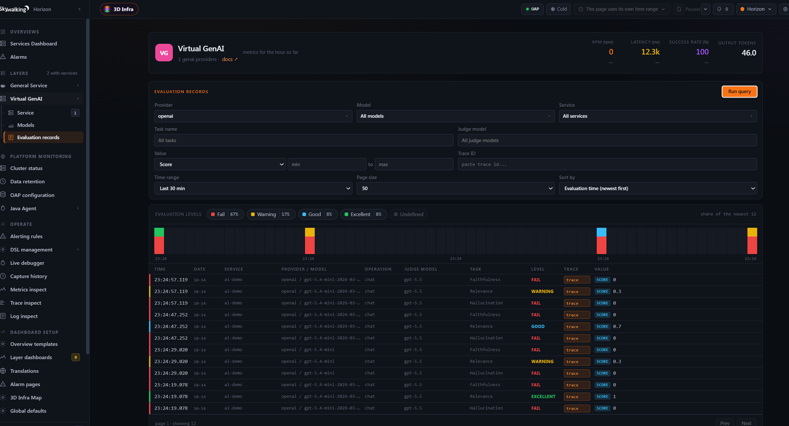
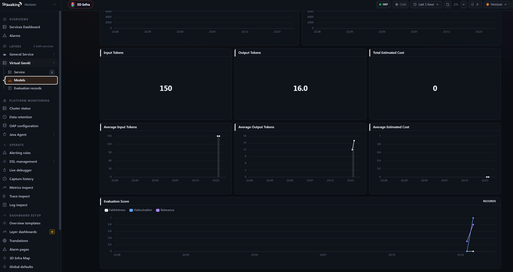

---
title: "LLM 回答得好不好？用 SkyWalking 把模型质量数据融入可观测性平台"
author: "peachisai"
date: 2026-10-15
description: "介绍即将在 SkyWalking 11.1.0 中发布的 LLM-as-Judge 功能：读取 GenAI Span 的输入和输出消息，异步评估真实请求，并将结果写入评估记录、指标和 Trace。"
tags:
  - LLM as judge
  - AI evaluation
  - observability
---

## 介绍

传统可观测性通常关注服务接口的错误率和延迟，但这些指标无法说明 LLM 的回答是否忠实于上下文、切中问题或完成了任务。知识库问答可能返回格式完整、语气肯定，却没有依据的答案；请求在 Trace 中显示成功，业务用户仍然会觉得 AI“不靠谱”。在 AI 中转或代理场景中，模型版本、供应商状态和路由策略也可能变化，导致回答质量下降。

SkyWalking 已经支持基于 OpenTelemetry 的 GenAI 可观测性，可以观察调用量、成功率、延迟、Token 和预估成本等数据。即将发布的 SkyWalking 11.1.0 在此基础上增加了 LLM-as-Judge：对采样到的 GenAI Span 输入/输出消息调用一个 OpenAI-compatible Judge 模型，生成可配置的质量评估结果，并将结果关联到评估记录和原始 Trace。SCORE 类型的任务还会生成指标，供 Virtual GenAI Dashboard 和告警使用。

## 为什么需要接入 SkyWalking 的 LLM-as-Judge 功能

- 问题集和 Benchmark 在模型选型、Prompt 对比和版本发布前的回归测试中很有价值，但它们通常使用固定的问题和上下文，主要回答“在这组测试题上哪个版本表现更好”，难以持续反映生产环境中的回答质量。
- 线上请求一直在变化：用户问题和上下文不同，模型版本可能更新，供应商状态和业务流量也会波动。因此，生产系统除了离线测试，还需要持续评估真实请求，及时发现质量变化。
- LLM-as-Judge 可以为真实请求生成质量评估结果，SkyWalking 则能把结果放进已有的可观测链路中。借助 Trace，可以查看一次请求经历了哪些 LLM 交互和外部调用，排查回答质量下降是否与前序 LLM 输出、MCP 调用或其他外部接口返回的数据有关，并定位到具体节点。
- SkyWalking 的 Virtual GenAI Dashboard 和告警能力可以按时间观察质量指标趋势，并在指标异常时触发告警。这样，LLM-as-Judge 就不只是“让另一个模型打分”，而是把真实请求的质量评估、趋势监控、异常告警和 Trace 排查串成生产观测闭环。

## 数据流转


- 简洁链路图：

  ```text
  GenAI Span（含非空输入/输出消息）
      → 按 Trace ID 抽样
      → OAP 异步队列
      → 构造评估任务与 Prompt
      → OpenAI-compatible Judge
      → 解析结构化结果
      → 评估记录 + SCORE 指标
      → Virtual GenAI Dashboard / 评估结果页 / 原始 Trace
  ```

评估在 Trace 处理之后异步执行，不会同步阻塞 Trace 接收。模块只处理同时包含非空 `gen_ai.input.messages` 和 `gen_ai.output.messages` 的 GenAI Span；缺少任一属性的 Span 会被跳过。

## 使用文档

本文面向 SkyWalking 11.1.0。在该版本正式发布前，请使用 `11.1.0-SNAPSHOT` 开发版本。

### 1. 开启模块

在 SkyWalking 的 `application.yml` 中配置：

```yaml
ai-evaluation:
  selector: ${SW_AI_EVALUATION:default}
  default:
    sampleRate: ${SW_AI_EVALUATION_SAMPLE_RATE:1000000}
    bufferSize: ${SW_AI_EVALUATION_BUFFER_SIZE:100}
    consumerThreads: ${SW_AI_EVALUATION_CONSUMER_THREADS:8}
    # Maximum escaped characters included from each input/output message field.
    maxContentLength: ${SW_AI_EVALUATION_MAX_CONTENT_LENGTH:16384}
```

`sampleRate` 是百万分率（PPM）：`1000000` 表示评估所有符合条件的 Trace，`10000` 约表示 1%。采样基于 Trace ID，同一个 Trace 中的 Span 会保持一致。队列已满时，新的评估任务会被丢弃，不会阻塞 Trace 接收，因此调整 `bufferSize` 和 `consumerThreads` 前应确认 Judge 服务的吞吐能力。

仅设置 selector 还不足以完成评估。OAP 还需要在 `ai-evaluation.yml` 中配置有效的 endpoint、模型、API key 和 system prompt；这些配置缺失时，评估模块不会真正执行。

### 2. 配置 Judge 和评估任务

在 `ai-evaluation.yml` 中配置 Judge：

```yaml
judge:
  provider: openai
  endpoint: ${AI_EVALUATION_ENDPOINT:}
  model: ${AI_EVALUATION_MODEL:gpt-5.5}
  api-key: ${AI_EVALUATION_API_KEY:}
  request-timeout-seconds: 30
  max-retries: 2
  temperature: 0.2
  max_tokens: 100000
```

当前 `provider` 仅支持 `openai`，但 endpoint 可以是任何兼容 OpenAI Chat Completions 请求格式的服务。Judge 请求会包含 Span 中的输入和输出消息，请在生产环境启用前确认数据脱敏、隐私合规、第三方模型的数据处理策略和调用成本。

system prompt 必须要求 Judge 返回 JSON。默认示例如下：

```yaml
system-prompt: |
  You are an AI observability evaluator.

  Your task is to evaluate GenAI spans according to the evaluation tasks provided by the user.

  General Rules:

  1. Return ONLY valid JSON.
  2. Do NOT return markdown.
  3. Do NOT return code fences.
  4. Do NOT return explanations outside the JSON result.
  5. Do NOT add any fields that are not requested.
  6. Do NOT omit any evaluation task.
  7. The JSON keys MUST appear in exactly the same order as the evaluation tasks provided by the user.
  8. Each evaluation task MUST contain:
     - value
     - reason
  9. The reason field should be concise and explain the evaluation result in one or two sentences.
  10. If the available context is insufficient, provide the best evaluation possible and explain the limitation in the reason field.

  Value Type Rules:

  SCORE
  - value must be a number between 0.0 and 1.0.
  - 1.0 represents the best possible evaluation result.
  - 0.0 represents the worst possible evaluation result.

  BOOLEAN
  - value must be either true or false.

  STRING
  - value must be a string.

  JSON
  - value must be a valid JSON object.

  Evaluation Principles:

  - Evaluate only using the information provided in the span context.
  - Do not assume facts that are not present in the input.
  - Do not invent missing information.
  - Be objective and consistent.
  - Use the task instruction as the primary evaluation criterion.

  Return ONLY the JSON object.
```

可以使用 `level` 为 SCORE 和 BOOLEAN 结果定义质量级别。SCORE 区间采用左闭右开，`1.0` 会包含在最后一个区间中：

```yaml
level:
  undefined: undefined
  score:
    - min: 0.0
      max: 0.3
      level: fail
    - min: 0.3
      max: 0.6
      level: warning
    - min: 0.6
      max: 0.85
      level: good
    - min: 0.85
      max: 1.0
      level: excellent
  boolean:
    "true": excellent
    "false": fail
```

评估任务需要设置 `name`、`valueType` 和 `instruction`。支持的 `valueType` 包括 `SCORE`、`BOOLEAN`、`STRING` 和 `JSON`。评估记录会保存所有任务的结果：`SCORE` 会保存 0.0 到 1.0 的分数，`BOOLEAN` 会保存转换后的 0 或 1 数值，`STRING` 和 `JSON` 会保存字符串结果。只有 `SCORE` 任务会额外上报 `gen_ai_model_evaluation_score_ppm` 指标；该指标不会包含 BOOLEAN、STRING 或 JSON 任务。

```yaml
tasks:
  - name: Faithfulness
    valueType: SCORE
    instruction: Evaluate factual grounding. Higher is better.

  - name: Relevance
    valueType: SCORE
    instruction: Evaluate response relevance. Higher is better.

  - name: TaskCompletion
    valueType: BOOLEAN
    instruction: Evaluate task completion.

  - name: Hallucination
    valueType: SCORE
    instruction: Evaluate factuality and absence of hallucinations. Higher is better.
```

每个任务的结果都包含 `value` 和 `reason`。对于 SCORE，`value` 范围是 `0.0` 到 `1.0`，上报的指标以 PPM 存储，例如 `0.8` 会存储为 `800000`，展示时需要除以 `1000000`。BOOLEAN 结果在评估记录中以 0 或 1 保存，但不会上报到上述 SCORE 指标。用户也可以自定义评估维度，并为 STRING 任务配置 `allowedValues`。

### 3. 接收 GenAI Trace

启动 OAP 并接收 GenAI Trace。GenAI 可观测性接入方式请参考[GenAI 可观测性接入指南](../2026-04-05-virtual-genai-monitoring/)。请确认采集链路包含 `gen_ai.input.messages` 和 `gen_ai.output.messages`；否则 Span 不会进入评估队列。

### 4. 查看评估记录



在 SkyWalking UI 的评估结果页面，可以按任务、返回类型、Trace ID 等条件筛选评估记录。记录中还保留服务、Provider、模型、操作、任务、结果、级别、原因、Judge 模型和评估时间等信息。

### 5. 将评估结果关联到 Trace


点击评估任务可以查看结果详情：


点击右上角的 Trace 链接，可以跳转到具体 Trace，进一步查看完整的 Agent 交互、LLM 调用和外部工具调用。

### 6. 在 Dashboard 中查看质量指标



Virtual GenAI Dashboard 中提供 `gen_ai_model_evaluation_score_ppm` 指标。可以按服务实例、模型和任务观察 SCORE 趋势，并基于该指标配置告警。评估队列丢弃或 Judge 调用失败时，还可以关注 `ai_evaluation_dropped_count` 和 `ai_evaluation_error_count`，以免把评估吞吐问题误判为模型质量变化。

