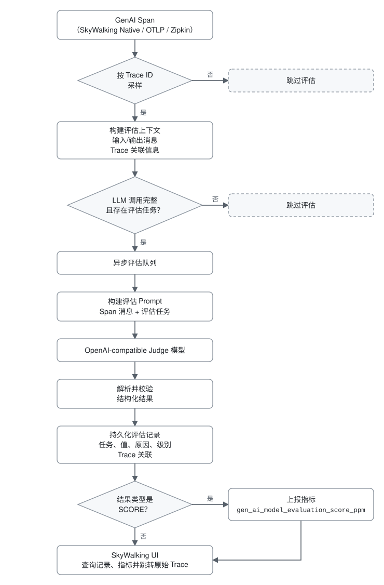
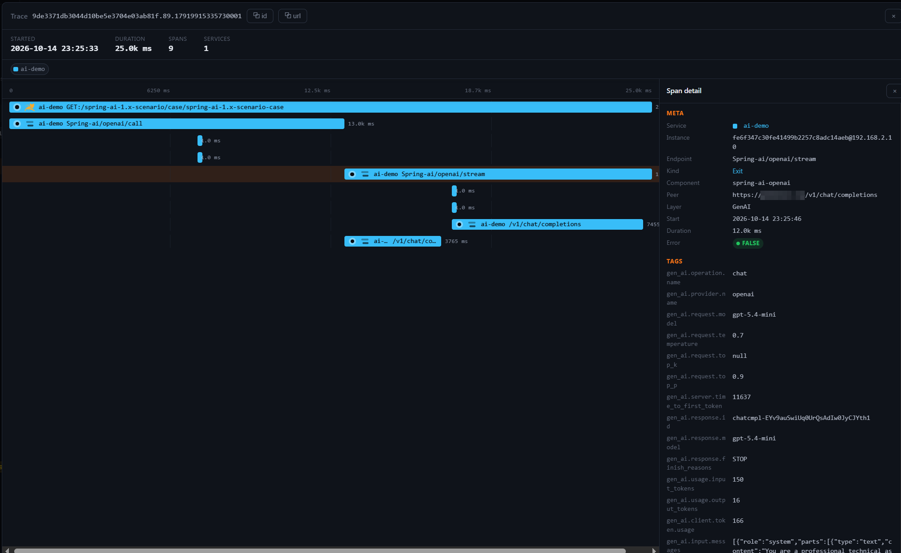

## 介绍

传统可观测性关注服务的错误率和延迟，但这些指标说明不了 LLM 的回答有没有上下文依据、是否切题、是否完整。知识库助手可能给出格式规范、语气笃定却没有依据的答案：Trace 显示请求成功，用户却觉得答案靠不住。在 AI 网关和探针中，模型版本、模型服务商的运行状态和路由策略也会变化，进而影响回答质量。

SkyWalking 已经基于 OpenTelemetry 提供 GenAI 可观测性，可以查看调用量、成功率、延迟、Token 用量和预估费用。即将发布的 SkyWalking 11.1.0 在此基础上加入了 LLM-as-Judge。OAP 从采样到的 GenAI Span 中取出输入和输出消息，发给一个 OpenAI-compatible 的 Judge 模型。Judge 按配置的任务评估回答质量，OAP 把结果存为评估记录，并关联到原始 Trace。`SCORE` 类型的任务还会生成指标，供 Virtual GenAI Dashboard 和告警使用。

## 为什么把质量评估接入 SkyWalking

- 数据集和 Benchmark 适合用在模型选型、Prompt 对比和发布前的回归测试上。不过它们的问题和上下文通常是固定的，没法持续反映线上的回答质量。
- 线上请求一直在变：用户问题和上下文各不相同，模型版本会更新，模型服务商的状态和流量模式也在波动。所以生产系统除了离线测试，还需要持续评估真实请求。
- LLM-as-Judge 负责评估真实请求的回答质量，SkyWalking 则把评估结果和已有的 Trace、指标放在一起。Trace 能展示一次请求经过了哪些 LLM 交互和外部调用；回答质量下降时，可以据此判断问题是否和前序 LLM 的输出、MCP 调用或其他外部接口的返回有关。
- Virtual GenAI Dashboard 和告警可以按时间展示质量趋势，并在数值异常时告警。这样，质量评估、趋势监控、告警和 Trace 排查就连成了一个线上观测闭环。

## 数据流转



评估是异步的：符合条件的 GenAI Span 先进入队列，Trace 接收不用等待 Judge 返回。只有 `gen_ai.input.messages` 和 `gen_ai.output.messages` 都非空的 GenAI Span 才会参与评估，缺任何一个就直接跳过。

## 接入步骤

本文以 SkyWalking 11.1.0 为准。正式发布前，OAP 请使用 `11.1.0-SNAPSHOT` 开发版本。下文截图中的评估页面目前只在 Horizon UI 的 `main` 分支中，Horizon UI 1.0.1 还没有；在 Horizon UI 1.1.0 发布前，请使用 `ghcr.io/apache/skywalking-horizon-ui:main` 镜像。

### 1. 开启模块

模块默认关闭，启动 OAP 时设置 `SW_AI_EVALUATION=default` 即可开启。`application.yml` 中的模块配置如下：

```yaml
ai-evaluation:
  selector: ${SW_AI_EVALUATION:-}
  default:
    sampleRate: ${SW_AI_EVALUATION_SAMPLE_RATE:1000000}
    bufferSize: ${SW_AI_EVALUATION_BUFFER_SIZE:100}
    consumerThreads: ${SW_AI_EVALUATION_CONSUMER_THREADS:8}
    # Maximum escaped characters included from each input/output message field.
    maxContentLength: ${SW_AI_EVALUATION_MAX_CONTENT_LENGTH:16384}
```

`sampleRate` 的单位是百万分之一（PPM）：`1000000` 表示评估所有符合条件的 Trace，`10000` 约为 1%。采样按 Trace ID 进行，同一条 Trace 中的 Span 采样结果一致。队列满了以后，OAP 会直接丢弃新的评估任务，不会阻塞 Trace 接收。调整 `bufferSize` 和 `consumerThreads` 之前，先确认 Judge 服务能承受多少请求，再看看 OAP 的资源占用。

只设置 `selector` 还不够，还要在 `ai-evaluation.yml` 中配置有效的 `endpoint`、模型、API Key 和系统 Prompt。缺少其中任何一项，评估模块都不会工作。

### 2. 配置 Judge 和评估任务

在 `ai-evaluation.yml` 中配置 Judge：

```yaml
judge:
  provider: openai
  endpoint: ${AI_EVALUATION_ENDPOINT:}
  model: ${AI_EVALUATION_MODEL:gpt-5.5}
  api-key: ${AI_EVALUATION_API_KEY:}
  request-timeout-seconds: 30
  max-retries: 2
  temperature: 0.2
  max_tokens: 100000
```

目前 `provider` 只支持 `openai`。`endpoint` 可以指向任何兼容 OpenAI Chat Completions 的服务：它要能接受 Chat Completions 请求，并在响应的 `choices[0].message.content` 中返回 Judge 的 JSON 结果。Judge 请求会带上 Span 中的输入和输出消息。在生产环境启用前，请先确认数据脱敏和隐私要求，了解服务提供方的数据处理政策，并估算模型调用费用。

系统 Prompt 必须要求 Judge 返回 JSON。默认配置如下：

```yaml
system-prompt: |
  You are an AI observability evaluator.

  Your task is to evaluate GenAI spans according to the evaluation tasks provided by the user.

  General Rules:

  1. Return ONLY valid JSON.
  2. Do NOT return markdown.
  3. Do NOT return code fences.
  4. Do NOT return explanations outside the JSON result.
  5. Do NOT add any fields that are not requested.
  6. Do NOT omit any evaluation task.
  7. The JSON keys MUST appear in exactly the same order as the evaluation tasks provided by the user.
  8. Each evaluation task MUST contain:
     - value
     - reason
  9. The reason field should be concise and explain the evaluation result in one or two sentences.
  10. If the available context is insufficient, provide the best evaluation possible and explain the limitation in the reason field.

  Value Type Rules:

  SCORE
  - value must be a number between 0.0 and 1.0.
  - 1.0 represents the best possible evaluation result.
  - 0.0 represents the worst possible evaluation result.

  BOOLEAN
  - value must be either true or false.

  STRING
  - value must be a string.

  JSON
  - value must be a valid JSON object.

  Evaluation Principles:

  - Evaluate only using the information provided in the span context.
  - Do not assume facts that are not present in the input.
  - Do not invent missing information.
  - Be objective and consistent.
  - Use the task instruction as the primary evaluation criterion.

  Return ONLY the JSON object.
```

可以在 `level` 中为 `SCORE` 和 `BOOLEAN` 结果配置等级。`SCORE` 区间包含 `min`、不包含 `max`；`max` 为 `1.0` 的区间也包含 `1.0` 本身：

```yaml
level:
  undefined: undefined
  score:
    - min: 0.0
      max: 0.3
      level: fail
    - min: 0.3
      max: 0.6
      level: warning
    - min: 0.6
      max: 0.85
      level: good
    - min: 0.85
      max: 1.0
      level: excellent
  boolean:
    "true": excellent
    "false": fail
```

每个评估任务都要设置 `name`、`valueType` 和 `instruction`。`valueType` 支持 `SCORE`、`BOOLEAN`、`STRING` 和 `JSON`。评估记录保存所有合法的任务结果，不合法的结果直接跳过。`SCORE` 和 `BOOLEAN` 按 PPM 存为数值（分数 `0.8` 存为 `800000`，`true` 存为 `1000000`，`false` 存为 `0`），`STRING` 和 `JSON` 按字符串保存。只有 `SCORE` 任务会额外上报 `gen_ai_model_evaluation_score_ppm` 指标，其他类型只生成评估记录。

```yaml
tasks:
  - name: Faithfulness
    valueType: SCORE
    instruction: Evaluate factual grounding. Higher is better.

  - name: Relevance
    valueType: SCORE
    instruction: Evaluate response relevance. Higher is better.

  - name: TaskCompletion
    valueType: BOOLEAN
    instruction: Evaluate task completion.

  - name: Hallucination
    valueType: SCORE
    instruction: Evaluate factuality and absence of hallucinations. Higher is better.
```

系统 Prompt 把 `1.0` 当作最好的结果，上面的等级规则也是分数越高、等级越好，所以每个 `SCORE` 任务的 `instruction` 都要写成“分数越高，回答越好”。这也是为什么上面的 Hallucination 任务评的是“有没有幻觉”，而不是“幻觉有多严重”。

每个任务的结果都包含 `value` 和 `reason`。评估记录和指标中的 `SCORE` 值都是 PPM，展示原始分数时除以 `1000000` 即可。你也可以自定义评估维度，并为 `STRING` 任务配置 `allowedValues`。

### 3. 接收 GenAI Trace

启动 OAP，并向 SkyWalking 上报 GenAI Trace，接入方法见 [GenAI 可观测性接入指南](../2026-04-05-virtual-genai-monitoring/)。评估需要消息内容，而 SkyWalking Java 探针默认不采集。用 Java 探针接入 Spring AI 时，需要在业务应用的启动环境中显式开启：

```shell
export SW_PLUGIN_SPRINGAI_COLLECT_INPUT_MESSAGES=true
export SW_PLUGIN_SPRINGAI_COLLECT_OUTPUT_MESSAGES=true
```

通过 OTLP 或 Zipkin 接入时，请确认采集端会导出 `gen_ai.input.messages` 和 `gen_ai.output.messages`。缺少任一属性的 Span 不会进入评估队列。

通过 OTLP 接入时，OAP 11.1.0 默认原生存储 Span（`otlpTraceStorage: otlp`），并直接评估这些 Span，无需转换为 Zipkin 格式。

### 4. 查看评估记录


在 Horizon UI 中打开 **Virtual GenAI > Evaluation records**，可以按任务、值类型、Trace ID 等条件筛选记录。每条记录还保留了服务、模型服务商、模型、操作、任务、评估值、等级、原因、Judge 模型和评估时间。

### 5. 从评估记录查看原始 Trace

点击一条记录，查看评估详情：


记录来自 SkyWalking 原生 Trace 时，有 `traces:read` 权限即可点击右上角的 **trace** 链接，打开原始 Trace（如下图）。在 Trace 中可以查看采集到的 Agent 交互、LLM 调用和外部工具调用。



Horizon UI 的 `main` 分支目前还不支持从 OTLP 评估记录跳转到原生存储的原始 Trace。这项 UI 限制不影响评估记录的生成和查询。

### 6. 在 Dashboard 中查看质量指标


Virtual GenAI 的 Models 页面展示了 `gen_ai_model_evaluation_score_ppm` 指标。在 Virtual GenAI 中，模型服务商对应服务，模型对应服务实例，所以这里看到的是按模型和任务划分的 `SCORE` 趋势。你也可以基于这个指标配置告警。

另外，还要持续关注 OAP 自观测指标 `ai_evaluation_dropped_count` 和 `ai_evaluation_error_count`（存储名分别为 `meter_oap_instance_ai_evaluation_dropped_count` 和 `meter_oap_instance_ai_evaluation_error_count`），以免把评估本身的问题误判为模型回答质量下降。具体原因看 `reason` 标签：丢弃原因有两种，`pipeline_capacity` 表示队列已满，`incomplete_span` 表示缺少评估上下文或 Trace ID，或者 Span 缺少所需的消息、服务、模型服务商、模型或 Trace 关联信息；错误原因分为 `rejected`、`timeout` 和 `invalid_response`。
