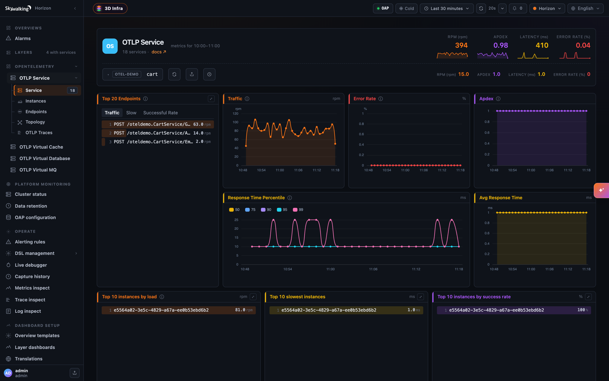
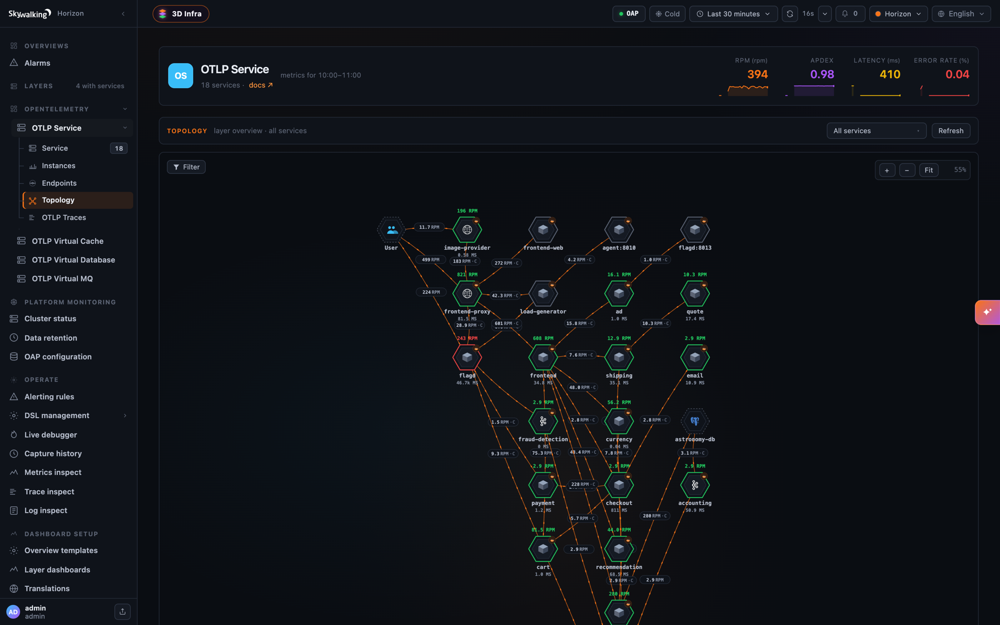
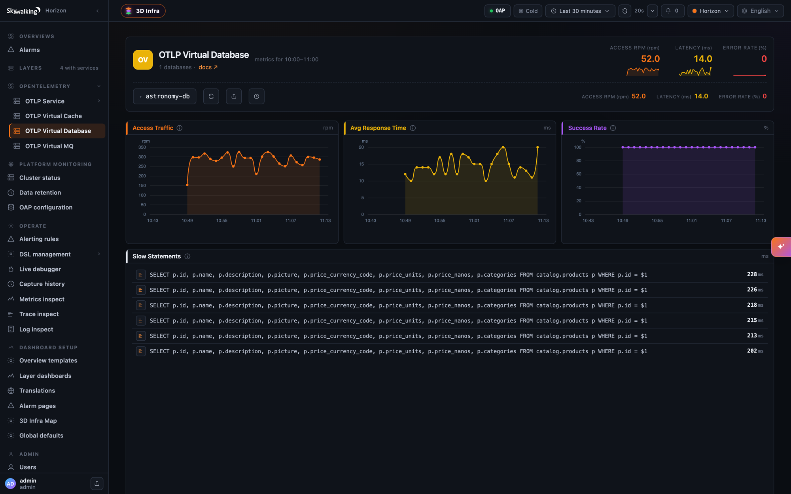
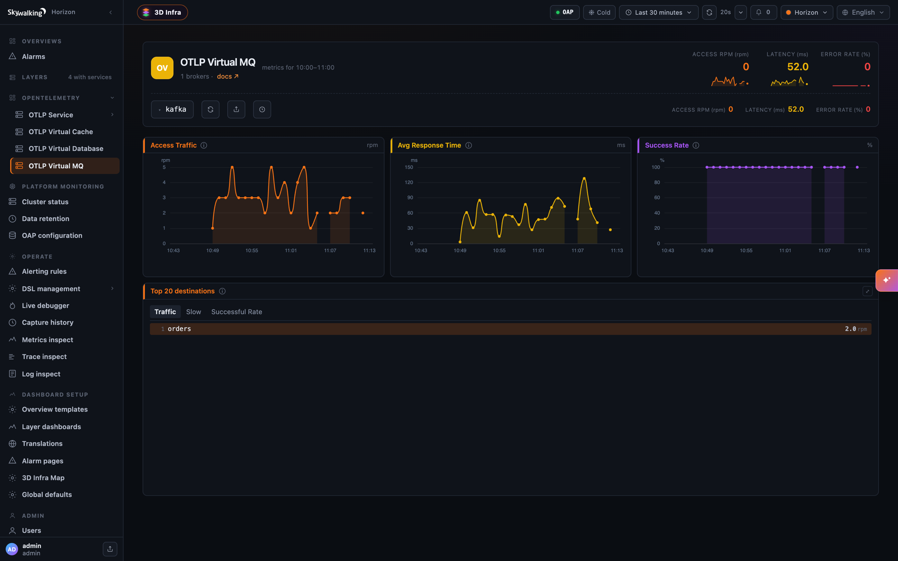
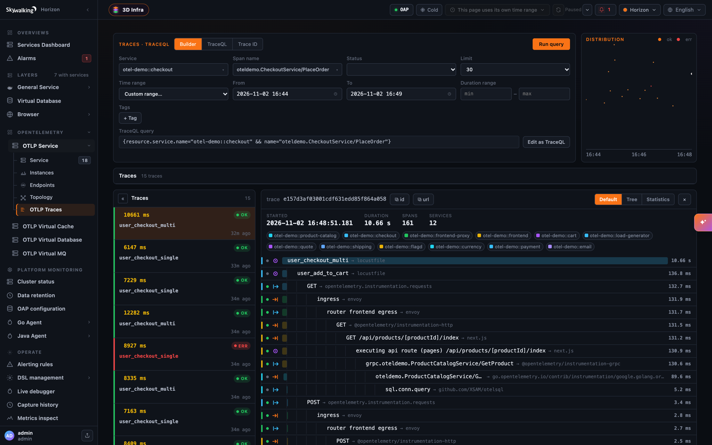
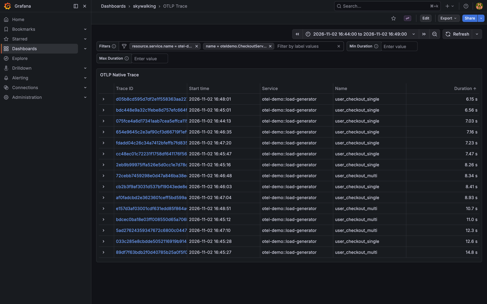
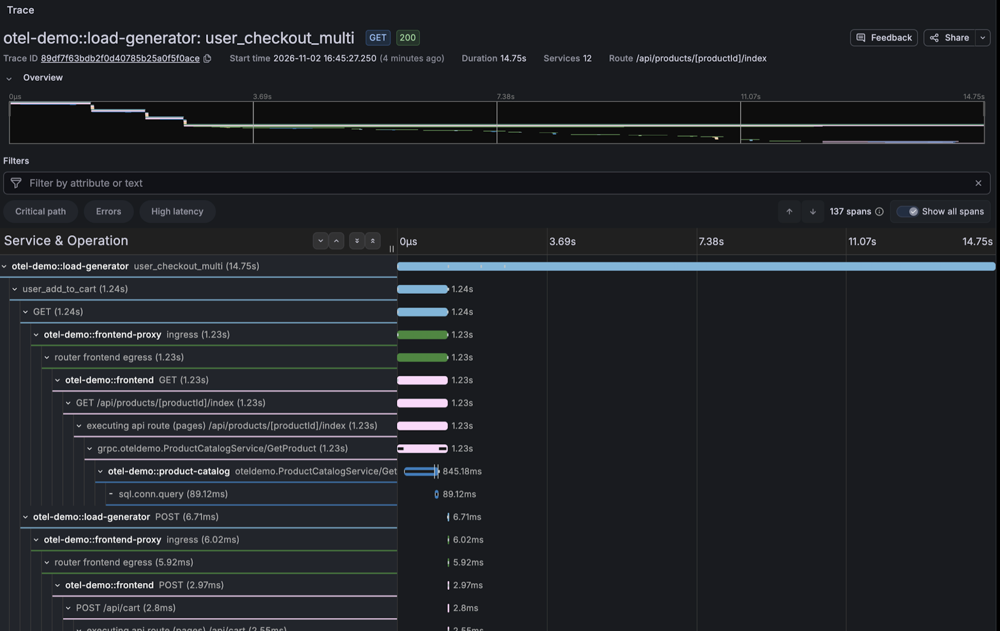

*[英文原文 / English version](/blog/2026-11-03-otlp-traces-in-skywalking/)*

如果服务已经接入 OpenTelemetry SDK，只要把 OTLP 导出器指向 OAP，再添加一个资源属性，就可以直接使用 SkyWalking 的服务仪表盘、拓扑和链路搜索，无需另外安装 SkyWalking 探针。SkyWalking 会用上报的 Span 完成以下三件事。

- **存储和查询链路**。SkyWalking 按 SDK 上报的格式保存链路，可以在 Horizon UI 或 Grafana 中用 TraceQL 查询。
- **计算服务、实例和端点指标**。每个 Span 都参与统计，涵盖流量、延迟及其百分位数、成功率和 Apdex。指标的命名和统计口径与基于 SkyWalking 探针的 `GENERAL` 层一致。
- **构建调用拓扑**。拓扑中既有应用服务，也有它们访问的数据库、缓存和消息代理，各自都有对应的仪表盘。

下面使用 [SkyWalking Showcase](https://github.com/apache/skywalking-showcase) 在笔记本电脑上运行 [OpenTelemetry Astronomy Shop](https://github.com/open-telemetry/opentelemetry-demo)，走一遍从上报到查询的过程，最后再把同样的配置用到自己的应用上。

> 本文介绍的功能从 SkyWalking **11.1.0** 起提供。

## SkyWalking 11.1.0 的变化

早期版本也能接收 OTLP 链路，但会先把每个 Span 转成 Zipkin v2 格式，再保存转换后的副本。这种转换会丢失 `INTERNAL` Span 的类型，把所有属性值都转为字符串，把事件和链接摊平成标签，还会把资源（Resource）和插桩作用域（Instrumentation Scope）合并到 Span 上。这些 Span 仅用于存储，无法据此生成服务指标或拓扑。

11.1.0 同时改进了存储和分析。

1. **原生存储 OTLP 链路**。`receiver-otel` 按收到的 `ResourceSpans` 格式保存每个 Span，对应的配置 `otlpTraceStorage: otlp` 现已成为默认值。查询时可以取回 SDK 发来的资源、插桩作用域、保留原始类型的属性、事件、链接和状态。TraceQL 模块通过 `http://<oap>:3200/otlp` 提供查询，Horizon UI 可直接使用这个接口，Grafana 则通过 Tempo 数据源访问它。
2. **引入链路分析语言（Trace Analysis Language，TAL）**。新的 `trace-analyzer` 模块对接收到的每个 Span 执行规则，生成指标、拓扑和记录。内置规则文件 `tal/otlp-general.yaml` 按 OpenTelemetry 语义约定读取属性，将分析结果归入以下四个层。

| 层 | Horizon UI 中的名称 | 包含的对象 |
|---|---|---|
| `OTLP_GENERAL` | OTLP Service | 应用服务及其实例和端点 |
| `OTLP_VIRTUAL_DATABASE` | OTLP Virtual Database | 客户端 Span 通过 `db.system.name` 标识的数据库 |
| `OTLP_VIRTUAL_CACHE` | OTLP Virtual Cache | Redis、Valkey、Memcached 等缓存系统 |
| `OTLP_VIRTUAL_MQ` | OTLP Virtual MQ | 生产者和消费者 Span 标识的消息代理 |

第五个层 `OTLP_MESH` 用于标记服务网格 Sidecar 上报的 Span。这些 Span 可以存储和查询，但内置规则不对它们做分析。详见[服务网格中的 Sidecar](#service-mesh-sidecars)。

```
 OTel SDKs ──OTLP──▶ OTel Collector ──OTLP gRPC :11800──▶ OAP receiver-otel
                                                           │
                                   ┌───────────────────────┴───────────────────────┐
                                   ▼                                               ▼
                       trace-analyzer（TAL 规则）                              otlp_span
                         指标、拓扑、慢语句                                        │
                                   │                                               │
                                   ▼                                               ▼
                          Horizon UI 分层仪表盘                    TraceQL /otlp，端口 3200（Horizon、Grafana）
```

Collector 是可选的。SDK 也可以直接向 OAP 上报，使用 OTLP/gRPC 时连接 `11800` 端口，使用 OTLP/HTTP 时向 `12800` 端口的 `/v1/traces` 发送 `POST` 请求，支持 protobuf 和 JSON。

如需沿用 Zipkin 存储方式，可设置 `SW_OTEL_TRACE_STORAGE=zipkin`，同时启用 Zipkin 接收器（`SW_RECEIVER_ZIPKIN=default`）和查询模块（`SW_QUERY_ZIPKIN=default`）。在该模式下，未启用 Zipkin 接收器会导致 OAP 拒绝启动。Span 会转换为 Zipkin v2，可通过 Zipkin API、Lens UI 或 TraceQL 的 `/zipkin` 数据源查询。从 11.1.0 起，这些 Span 也会参与链路分析。

## 一条命令启动演示环境

先安装 `git`、`make` 和 Docker，并为 Docker 预留约 10 GB 可用内存。以下容器启动后约占 8.5 GB。

```shell
git clone https://github.com/apache/skywalking-showcase.git
cd skywalking-showcase
make deploy.docker FEATURE_FLAGS=single-node,otlp-trace,grafana
```

这条命令启用了三个功能开关。

- `single-node` 部署 BanyanDB、一个 OAP 实例和 Horizon UI。
- `otlp-trace` 部署 Astronomy Shop。它包含用多种语言编写的微服务，每个服务都接入了对应语言的 OpenTelemetry SDK。环境中还包括这些服务使用的 Postgres、Valkey 和 Kafka，一个将所有 Span 转发给 OAP 的 OpenTelemetry Collector，以及用于生成负载的 Locust。
- `grafana` 部署 Grafana，并预置名为 `OTLPTraceQL` 的 Tempo 数据源和 `OTLP Trace` 仪表盘。此项可选。

首次运行需要拉取镜像，可能要等一会儿。等 `docker ps` 显示容器状态为 healthy，即可通过下表中的地址访问服务。

| 服务 | 地址 | 用户名 / 密码 |
|---|---|---|
| Horizon UI | http://localhost:8081 | `admin` / `admin` |
| Astronomy Shop | http://localhost:8088 | — |
| Grafana | http://localhost:3000 | `admin` / `admin` |

Locust 会自动开始发请求，几分钟后就能在 Horizon UI 里看到各个服务。

如果在 Docker Desktop 上长时间运行演示，结账链路的耗时可能会显示为几分钟。原因是 PHP 编写的 `quote` 服务运行久了，时间戳会逐渐落后于实际时间，它的 Span 也就与其他服务的 Span 错开了。执行 `docker restart docker-otel-demo-quote-1` 重启该服务，时间就会重新对齐。

演示结束后，用同一组功能开关清理环境。

```shell
make undeploy.docker FEATURE_FLAGS=single-node,otlp-trace,grafana
```

## Showcase 如何配置

整个功能只依赖下面三项配置，接入自己的应用时要设置的也正是这三项。

**1. 让 OAP 原生存储 OTLP 链路，并通过 TraceQL 提供查询。** 可以在 `deploy/platform/docker/docker-compose.single-node.yaml` 中看到这两项设置。

```yaml
  oap:
    environment:
      SW_TRACEQL: default
      SW_TRACEQL_ENABLE_DATASOURCE_OTLP: "true"   # 在 3200 端口提供 /otlp 数据源
```

OTLP 接收器默认启用，`otlpTraceStorage` 的默认值为 `otlp`。这种模式无需启用 Zipkin 接收器和 Zipkin 查询模块。

**2. 用 `service.layer=OTLP_GENERAL` 标记要分析的 Span。** 内置 TAL 规则只分析资源上带有这一属性值的 Span。其他 Span 也能存储和查询，但不会生成指标。Showcase 在 Collector 的 `config/opentelemetry-demo/otel-collector-config.yaml` 中统一添加该属性，一次配置即可覆盖所有服务。

```yaml
processors:
  resource/layer:
    attributes:
      - key: service.layer
        value: OTLP_GENERAL
        action: insert
```

**3. 按命名空间对服务分组。** 演示服务设置了 `service.namespace=otel-demo`。Showcase 在 `docker-compose.otlp-trace.yaml` 中使用以下设置，让 OAP 按这一属性分组。

```yaml
  oap:
    environment:
      SW_OTEL_RECEIVER_OTLP_SERVICE_GROUP: service.namespace
```

于是，在指标、拓扑、已存储的 Span 和日志里，`cart` 都会显示为 `otel-demo::cart`，沿用 SkyWalking 探针的 `group::name` 命名约定。服务分组是可选项，留空时服务名就是 `cart`。

## 服务仪表盘

打开 Horizon UI，选择 **OPENTELEMETRY → OTLP Service**，就能看到演示中的所有服务。和接入 SkyWalking 探针的服务一样，可以查看端点排行、流量、错误率、Apdex、响应时间百分位数以及实例列表。



实例信息来自资源属性 `service.instance.id`。只有部分 OpenTelemetry SDK 会设置它。演示中的 `cart`、`ad` 和 `payment` 会上报实例 ID，而 `frontend`、`checkout` 等服务没有上报，所以它们的实例面板是空的。可以自行补上这个属性，例如通过 `OTEL_RESOURCE_ATTRIBUTES` 将实例 ID 设为 Pod 名称。

OAP 在接收器执行头部采样（`otlpTraceSampleRate`）和限流（`otlpTraceMaxSpansPerSecond`）**之前**，就用收到的每个 Span 计算指标。因此，即使只存储采样后的部分链路，指标仍按全部收到的 Span 统计。

## 调用拓扑

打开 **OTLP Service → Topology**，可以看到服务之间的调用关系、表示外部请求入口的 `User` 节点，以及服务访问的数据库、缓存和消息代理。



OpenTelemetry 客户端 Span 不记录被调用的服务名，只记录它连接的地址。例如 `frontend` 调用的是 `cart:7070`，有时记录下来的甚至只是解析后的 Pod IP。那么 SkyWalking 如何从地址识别被调用的服务？链路分析器把客户端 Span 与它的直接子 Span（服务端 Span）配对，由此识别出 `otel-demo::frontend` 访问 `cart:7070` 时实际调用的是 `otel-demo::cart`，再在拓扑中把这个地址节点归并到该服务。

配对只在抽样选中的链路上进行（`pairingSamplePercent`，默认 25%），所以刚部署的头几分钟里，可能会先看到几个 `ip:port` 节点。每个调用方与目标地址的组合只要成功配对一次，这些节点就会归并到对应的服务。

如果找不到可配对的服务端 Span，地址就会作为独立节点保留。在 Showcase 中可以看到两个这样的节点。

- `agent:8010` 是演示应用的 AI Agent 地址。负载生成器也会向它发请求，但 Showcase 没有部署这个服务，所以请求得不到响应。
- `flagd:8013` 来自功能开关（feature flag）客户端的调用。部分客户端没有向 `flagd` 传递链路上下文，导致它的服务端 Span 开启了一条独立的链路，无法与调用方配对。

这两个节点都如实反映了 Span 记录的调用。如果自己的拓扑里本该显示服务名的地方只显示地址，请检查被调用方是否已完成插桩，以及调用方是否传递了链路上下文。

## 数据库、缓存和消息队列

在演示中，对 Postgres、Valkey 和 Kafka 的调用会产生客户端 Span。链路分析器据此在三个虚拟层中分别创建服务，统计访问流量、延迟和成功率。数据库仪表盘还会列出慢语句，即耗时超过 200 ms 的数据库客户端 Span。慢语句列表默认每 10 分钟刷新一次（`SW_CORE_TOPN_REPORT_PERIOD`）。





数据库、缓存和消息代理的服务名优先取客户端连接的地址。Span 中没有地址时，数据库或缓存使用 `db.system.name` 和 `db.namespace`，消息代理使用 `messaging.system`。如果客户端通过多个地址访问同一个集群，例如 Kafka 的引导服务器列表或 Redis 的多个副本，可以把这些地址列入 `server-clusters.yml`，使它们在拓扑中显示为同一个服务。

## 链路查询

在 **OTLP Service → OTLP Traces** 中，可以用 TraceQL 搜索已存储的 Span。可以在界面上组合查询条件，也可以直接输入下面的 TraceQL 表达式。第一条查找结账服务的下单操作，第二条查找 HTTP 响应状态码为 500 的 Span。

```
{resource.service.name="otel-demo::checkout" && name="oteldemo.CheckoutService/PlaceOrder"}
{resource.service.layer="OTLP_GENERAL" && span.http.response.status_code=500}
```

点开搜索结果就能看到完整链路。下图是负载生成器发起的一次结账请求，包含 12 个服务的 161 个 Span，从 Envoy 代理经过 Next.js 前端和 gRPC 服务，一直追踪到 SQL 调用。



由于 Span 按接收时的格式存储，查询结果保留了 SDK 上报的全部信息。以负责下单的 Go 服务 `otel-demo::checkout` 为例，查询一个 Span 可以看到以下信息。

- Span 类型，包括 `prepareOrderItemsAndShippingQuoteFromCart` 的 `SPAN_KIND_INTERNAL`。
- 属性及其类型。例如，`server.port` 和 `demo.cart.items.count` 是整数，`demo.shipping.amount` 是双精度浮点数。
- 插桩作用域，例如 `go.opentelemetry.io/contrib/instrumentation/google.golang.org/grpc/otelgrpc`。
- Span 事件和完整的资源属性，包括 `service.version`、`service.criticality`、`host.name`、`process.*`、`os.*` 和 `telemetry.sdk.*`。

在 Grafana 里也可以查看同一份数据。Showcase 预置了地址为 `http://oap:3200/otlp`、名为 `OTLPTraceQL` 的 Tempo 数据源，以及 **OTLP Trace** 仪表盘。在 **Filters** 栏中可以从下拉菜单选择筛选条件。先选 `resource.service.name`，再打开 `name`，就会列出该服务的 Span 名称。下图筛选出结账服务的 `PlaceOrder` Span。



点击链路 ID 即可打开完整链路。下图是另一次结账请求，包含 12 个服务的 137 个 Span。



要在自己的 Grafana（12 或更高版本）中使用这些仪表盘，请创建指向 `http://<oap-host>:3200/otlp` 的 Tempo 数据源，关闭其 **Streaming** 选项，再从 [deploy/platform/config/grafana/dashboards](https://github.com/apache/skywalking-showcase/tree/main/deploy/platform/config/grafana/dashboards) 导入仪表盘。

## 服务网格中的 Sidecar {#service-mesh-sidecars}

Envoy Sidecar 也可以上报 OTLP 链路。在 Istio 中，OpenTelemetry 追踪提供方（tracing provider）将每个 Sidecar 的 Span 发给 OAP，或先发送到 OAP 前面的 Collector。下面通过代理的环境变量给这些 Span 标上专属的层 `OTLP_MESH`。

```yaml
meshConfig:
  enableTracing: true
  defaultConfig:
    proxyMetadata:
      OTEL_RESOURCE_ATTRIBUTES: service.layer=OTLP_MESH
  extensionProviders:
    - name: skywalking-mesh-otlp
      opentelemetry:
        service: oap.skywalking.svc.cluster.local
        port: 11800
        resourceDetectors:
          environment: {}
```

`opentelemetry` 指定提供方使用 OTLP，默认通过 gRPC 发送。Istio 的 `skywalking` 提供方则使用 SkyWalking 原生协议。还需要在 `Telemetry` 资源中按名称选用这个提供方，追踪才会生效。下面的配置为整个网格选用该提供方。

```yaml
apiVersion: telemetry.istio.io/v1
kind: Telemetry
metadata:
  name: mesh-tracing
  namespace: istio-system
spec:
  tracing:
    - providers:
        - name: skywalking-mesh-otlp
      randomSamplingPercentage: 100
```

Showcase 在 Kubernetes 上通过 `als` 功能演示这种部署方式。先安装 `istioctl`，然后在 `FEATURE_FLAGS` 中加入 `als` 并运行 `make deploy.kubernetes`。Showcase 在网格中运行音乐应用，让 Sidecar 通过 OpenTelemetry Collector 上报 Span，并为这些 Span 的资源添加 `service.namespace=mesh-svr`。OAP 便按 `mesh-svr::<service>.<namespace>` 存储服务名，例如 `mesh-svr::songs.sample-services`。访问日志（ALS）分析在 `MESH` 层为该服务使用的也是这个名称。

OAP 会存储 Sidecar 上报的 Span，可以用 TraceQL 表达式 `{resource.service.layer="OTLP_MESH"}` 查询，但要注意以下两点限制。

- **这些 Span 不参与分析。** 没有任何内置 TAL 规则针对 `OTLP_MESH`，所以 Sidecar 既不会注册服务，也不会生成指标或拓扑。网格的指标和拓扑来自[访问日志分析](https://skywalking.apache.org/docs/main/next/en/setup/envoy/als_setting/)，Showcase 也正是把它和 Sidecar 链路搭配使用。
- **每一跳只追踪一次。** 如果在应用的 OpenTelemetry SDK（`service.layer=OTLP_GENERAL`）和旁边的 Envoy Sidecar 上都开启追踪，两者就会重复记录同一次调用，而且 Sidecar 的 Span 会插在两个应用 Span 之间。下面是 `frontend` 调用 `cart` 时出现的 Span 层级。

  ```
  frontend  CLIENT（应用，OTLP_GENERAL）
    frontend 的 Sidecar（OTLP_MESH）
      cart 的 Sidecar（OTLP_MESH）
        cart  SERVER（应用，OTLP_GENERAL）
  ```

  此时 `frontend` 的 CLIENT Span 和 `cart` 的 SERVER Span 失去了直接的父子关系。分析器无法将两者配对，`frontend` 访问的 `cart:7070` 也就无法归并到 `cart` 服务，拓扑里会保留一个以地址命名的节点。给 Sidecar 标记 `OTLP_MESH` 可以让分析器跳过它的 Span，但这些 Span 仍然留在链路中。所以应用和网格只能选一处开启追踪：要么只追踪应用，关闭 Sidecar 的追踪，让它透传链路上下文；要么只追踪网格，应用不做插桩。

  Showcase 的 `als` 演示用另一种方式把两者分开：应用使用 SkyWalking 探针，传播自己的 `sw8` 请求头，Sidecar 则传播 W3C 链路上下文。两者的传播协议不同，探针的链路和 Sidecar 的链路不会连到一起。

对于网格，我们的建议是：**需要网格的指标和拓扑时，使用 [Envoy 访问日志服务（ALS）](https://skywalking.apache.org/docs/main/next/en/setup/envoy/als_setting/)**。它分析 Sidecar 处理的每个请求，在 `MESH` 层生成服务、实例、端点和拓扑。如果还需要检索并查看单个请求的链路，再开启 Sidecar 的 OTLP 追踪。这正是 Showcase 的 `als` 配置。两者共用 `mesh-svr::` 命名约定，因此可以用同一个服务名查找 ALS 仪表盘和对应的 Sidecar 链路。

更多细节见链路分析文档中的[服务网格 Sidecar 一节](https://skywalking.apache.org/docs/main/next/en/setup/backend/trace-analyzer/#service-mesh-sidecars)。

## 接入自己的应用

前面的内容归结起来，就是下面几项配置。

**配置 OAP。** 默认配置已经能够接收 OTLP 链路并原生存储。下面两项 TraceQL 设置用于查询已存储的链路。

```shell
SW_TRACEQL=default
SW_TRACEQL_ENABLE_DATASOURCE_OTLP=true
# 如需按资源属性对服务分组（例如 otel-demo::cart），设置以下变量
SW_OTEL_RECEIVER_OTLP_SERVICE_GROUP=service.namespace
```

**配置应用。** 下面以 `cart` 服务为例。也可以像 Showcase 那样在 Collector 中统一添加资源属性。

```shell
OTEL_SERVICE_NAME=cart
OTEL_EXPORTER_OTLP_PROTOCOL=grpc                           # 多数 SDK 默认使用 http/protobuf
OTEL_EXPORTER_OTLP_ENDPOINT=http://<oap-host>:11800        # 使用 http/protobuf 时改用 12800 端口
OTEL_RESOURCE_ATTRIBUTES=service.layer=OTLP_GENERAL,service.namespace=shop
```

**配置 Horizon UI。** 除查询和管理接口的 URL 外，再配置 OAP 的 TraceQL API 地址 `HORIZON_OAP_TRACEQL_URL=http://<oap-host>:3200`，让 **OTLP Traces** 页签可以访问 `/otlp` 数据源。

如果能搜到某个服务的链路，但服务仪表盘仍是空的，请检查 Span 的资源是否缺少 `service.layer`。OAP 会为每个缺少该属性的服务记录一次以下日志。

```
Spans of service '…' carry no service.layer, so they are stored but not analyzed
```

还可以按需调整链路的存储和分析参数。

| 配置项（环境变量） | 默认值 | 作用 |
|---|---|---|
| `otlpTraceSampleRate`（`SW_OTEL_TRACE_SAMPLE_RATE`） | `10000` | 存储链路时的头部采样率，以万分之一为单位。指标按采样前的数据计算。 |
| `otlpTraceMaxSpansPerSecond`（`SW_OTEL_TRACE_MAX_SPANS_PER_SECOND`） | `0` | 每秒最多存储的 Span 数量，超出部分丢弃。`0` 表示不限流。 |
| `otlpTraceSearchableTags`（`SW_OTEL_TRACE_SEARCHABLE_TAG_KEYS`） | HTTP、RPC、数据库、消息队列和部署相关的属性键 | 控制标签自动补全提供哪些属性。所有属性都支持按值相等查询。 |
| `dedupWindow`（`SW_TRACE_TAL_DEDUP_WINDOW`） | `0` | 去重窗口，单位为秒。在窗口内因重试而重复上报的同一个 Span 只分析一次。 |

## 延伸阅读

- [OpenTelemetry 链路格式](https://skywalking.apache.org/docs/main/next/en/setup/backend/otlp-trace/)介绍存储模式、服务命名与分组，以及实际保存的内容。
- [OpenTelemetry 链路分析](https://skywalking.apache.org/docs/main/next/en/setup/backend/trace-analyzer/)介绍内置规则生成的层、指标、拓扑和记录，以及相应的配置。
- [链路分析语言（TAL）](https://skywalking.apache.org/docs/main/next/en/concepts-and-designs/tal/)介绍如何编写自己的规则。
- [使用 Grafana 作为 UI](https://skywalking.apache.org/docs/main/next/en/setup/backend/ui-grafana/)介绍 Tempo 数据源和链路仪表盘，包括 **OTLP Trace**。
- 接入不同类型的组件，可参考[网关](https://skywalking.apache.org/docs/main/next/en/setup/backend/otlp-trace-practices/gateway-overview/)、[消息队列](https://skywalking.apache.org/docs/main/next/en/setup/backend/otlp-trace-practices/message-queue/)以及[数据库和缓存](https://skywalking.apache.org/docs/main/next/en/setup/backend/otlp-trace-practices/database-and-cache/)的最佳实践。
- [SkyWalking Showcase](https://github.com/apache/skywalking-showcase) 的 `otlp-trace` 功能也可以在 Kubernetes 上运行，它会将演示应用的 Helm Chart 安装到 `otel-demo` 命名空间。
